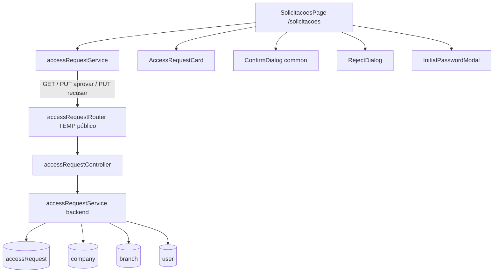

# access-requests-admin Design

**Spec**: `.specs/features/access-requests-admin/spec.md`
**Status**: Draft

---

## Architecture Overview

Segue o padrão do projeto (AD-002): Router → Controller (validação fail-fast) → Service (regra e Mongo). O backend já tem `POST /api/access-requests` montado **antes** de `app.use('/api', autenticar)` em `Backend/src/app.ts`; as três rotas novas entram no mesmo router, então ficam públicas sem mexer em `app.ts` (marcadas `// TEMP: travar com exigirAdmin`).

No front, uma página `SolicitacoesPage` em `/solicitacoes`, servida sem Sidebar/Header (entra em `AUTH_ROUTES` do `App.tsx`), com abas de status, um serviço `accessRequestService` e três peças pequenas: card, diálogo de recusa e modal da senha inicial. O diálogo de aceite reusa `ConfirmDialog`.



Backend e frontend não compartilham arquivo: o contrato entre eles é só o JSON descrito em **Data Models**. As duas trilhas rodam em paralelo.

---

## Code Reuse Analysis

### Existing Components to Leverage

| Component | Location | How to Use |
| --------- | -------- | ---------- |
| `respostaSucesso`, `responderErro`, `ErroHttp`, `StatusCode` | `Backend/src/utils/responseHandler.ts` | Controller responde; service lança `ErroHttp` com 400/404/409 |
| `lerId` (ObjectId → 400) | `Backend/src/feature/branch/branchController.ts:10` | Copiar o padrão (mesma mensagem "O ID fornecido não é um ObjectId válido do MongoDB.") |
| Compensação sem transação | `Backend/src/feature/machine/machineService.ts:110` (`criarMaquina`) | Mesmo padrão `ponytail:` para company → branch → user |
| Tradução de 11000 → 409 | `Backend/src/feature/machine/machineService.ts:25` | `company.nome` e `user.email` já são `unique`: corrida entre solicitações distintas vira 409 |
| `gerarHashSenha` / `verificarSenha` | `Backend/src/utils/senha.ts` | Hash da senha inicial; o teste usa `verificarSenha` para provar ACCR-03 AC3 |
| Formato do admin | `Backend/src/scripts/seedAdmin.ts` | `{ nome, email, role: 'admin', escopo: 'empresa', empresaId, senhaHash }` |
| Nome da matriz | `Backend/src/scripts/seedDataset.ts` (`MATRIZ_NOME`) | Importar a constante em vez de repetir `'Matriz'` |
| Testes do controller com models mockados | `Backend/tests/unit/accessRequestController.test.ts` | Estender no mesmo estilo |
| `api` (axios) | `Frontend/src/services/api.ts` | Serviço novo usa `api.get/put` |
| `Modal`, `ConfirmDialog`, `DialogButtons.module.css` | `Frontend/src/components/common/` | Base dos diálogos; `ConfirmDialog` ganha `confirmLabel` opcional |
| `useToast` (`show`, `showError`) | `Frontend/src/components/common/Toast.tsx` | Erro de salvar e conflito; `ToastProvider` já está em `main.tsx` |
| `PageSkeleton` (`variant="grid"`, `card="employee"`) | `Frontend/src/components/common/PageSkeleton.tsx` | Skeleton da lista |
| Estado `loading/ready/error` + `attempt` + `common.retry` | `Frontend/src/pages/EquipePage.tsx:47-81,258-268` | Mesmo fluxo de carga, erro e "Tentar novamente" |
| `TeamForm.module.css` | `Frontend/src/components/team/TeamForm.module.css` | Campo de motivo no `RejectDialog` |
| `formatEventDate` | `Frontend/src/utils/format.ts:17` | Data de envio no card |

### Integration Points

| System | Integration Method |
| ------ | ------------------ |
| `app.ts` | Nenhuma mudança: o router já está montado entre as rotas públicas |
| Login (`authService.login`) | Admin criado com `role: 'admin'` + `email` + `senhaHash` entra pelo `POST /api/auth/login` existente |
| `App.tsx` `AUTH_ROUTES` | Adicionar `'/solicitacoes'` |
| `appRoutes.tsx` | `<Route path="/solicitacoes" element={<SolicitacoesPage />} />` |
| i18n | Módulo novo `accessRequests` nos 7 `locales/*/translation.json` |

---

## Components

### Backend: schema `accessRequest` (modificar)

- **Location**: `Backend/src/schemas/accessRequest.ts`
- **Mudança**: `status` ganha `enum: ['pendente', 'aprovando', 'aprovada', 'recusada']` (default segue `pendente`); campos novos `empresaId` (ObjectId ref `company`, opcional), `decididaEm` (Date), `motivoRecusa` (String, trim, `maxlength: 200`).
- `aprovando` é interno (claim do aceite); nunca é aceito em `?status`.

### Backend: `accessRequestService` (novo)

- **Location**: `Backend/src/feature/accessRequest/accessRequestService.ts`
- **Interfaces**:
  - `listar(status?: 'pendente' | 'aprovada' | 'recusada')` → `AccessRequest.find({ status: status ?? 'pendente' }).sort({ createdAt: status ? -1 : 1 }).lean()`
  - `aprovar(id: string)` → `{ ...solicitacao, senhaInicial }`
  - `recusar(id: string, motivo?: string)` → solicitação recusada
  - `gerarSenhaInicial()` → `randomBytes(9).toString('base64url')` (12 caracteres)
- **Reuses**: `senha.ts`, padrão de compensação do `machineService`, `MATRIZ_NOME`.

#### Atomicidade e claim (ACCR-03, ACCR-04)

Mongo sem replica set (mesma premissa do `machineService.criarMaquina`): sem transação. O aceite usa um **claim atômico** e **compensação**:

1. **Claim**: `AccessRequest.findOneAndUpdate({ _id: id, status: 'pendente' }, { $set: { status: 'aprovando' } }, { returnDocument: 'after' }).lean()`. Só uma chamada concorrente ganha (o `findOneAndUpdate` é atômico no documento) → ACCR-04 AC8.
2. Claim nulo → `AccessRequest.exists({ _id: id })` decide: existe → 409 "Solicitação já decidida."; não existe → 404 "Solicitação não encontrada.". Uma segunda chamada simultânea vê `aprovando` e cai em 409.
3. Dentro de `try`, em ordem:
   - `User.exists({ email })` → 409 "Já existe um usuário com este e-mail."
   - `Company.exists({ nome: nomeEmpresa })` → 409 "Já existe uma empresa com este nome."
   - `Company.create({ nome })`, `Branch.create({ nome: MATRIZ_NOME, empresaId, matriz: true })`, `User.create({ nome: nomeAdministrador, email, role: 'admin', escopo: 'empresa', empresaId, senhaHash })`. Cada `_id` criado vai para uma lista.
   - Erro 11000 em `company` ou `user` (corrida entre solicitações diferentes com o mesmo nome/e-mail) vira o mesmo 409 da checagem.
4. `catch`: apaga o que foi criado na ordem inversa (`User.deleteOne`, `Branch.deleteOne`, `Company.deleteOne`), devolve o claim com `updateOne({ _id: id, status: 'aprovando' }, { $set: { status: 'pendente' } })` e relança → ACCR-04 AC4-6.
5. Sucesso: `findOneAndUpdate({ _id: id }, { $set: { status: 'aprovada', empresaId, decididaEm: new Date() } }, { returnDocument: 'after' }).lean()` e devolve com `senhaInicial` (texto só aqui; no banco só `senhaHash`) → ACCR-03 AC1-2.

`// ponytail: claim + compensação sem transação; um crash entre o claim e o passo 5 deixa a solicitação em 'aprovando' (fora das abas). Trocar por transação quando houver replica set.`

A recusa é um passo só, também atômico: `findOneAndUpdate({ _id: id, status: 'pendente' }, { $set: { status: 'recusada', decididaEm: new Date(), ...(motivo && { motivoRecusa: motivo }) } }, { returnDocument: 'after' }).lean()` (motivo vazio não grava o campo); nulo → mesmo 404/409 do passo 2. Fica num helper `naoPendente(id)` usado pelos dois.

### Backend: `accessRequestController` (modificar) e router

- **Location**: `Backend/src/feature/accessRequest/accessRequestController.ts`, `accessRequestRouter.ts`
- **Interfaces** (`criar` existente fica como está):
  - `listar(req, res)`: `req.query.status` ausente → `listar()`; fora de `pendente|aprovada|recusada` (inclusive array ou `aprovando`) → 400 "O campo 'status' deve ser pendente, aprovada ou recusada."
  - `aprovar(req, res)`: `lerId` → 400; `responderErro` no resto.
  - `recusar(req, res)`: `lerId`; `motivo` ausente/`null` → sem motivo; não-string ou `trim().length > 200` → 400 "O campo 'motivo' deve ser texto de até 200 caracteres."; vazio após trim → sem motivo.
- Router: `router.get('/', listar)`, `router.put('/:id/aprovar', aprovar)`, `router.put('/:id/recusar', recusar)` com `// TEMP: sem auth por decisão do dono; travar com exigirAdmin`.

### Frontend: `accessRequestService` (novo)

- **Location**: `Frontend/src/services/accessRequestService.ts`
- **Interfaces**:
  - `listar(status: AccessRequestStatus): Promise<AccessRequest[]>` → `pendente` chama `GET /access-requests` sem params (FIFO, AC1); os outros chamam com `{ params: { status } }`.
  - `aprovar(id): Promise<AccessRequest & { senhaInicial: string }>` → `PUT /access-requests/:id/aprovar`
  - `recusar(id, motivo): Promise<AccessRequest>` → `PUT /access-requests/:id/recusar` com `{ motivo }`
- `authService.solicitarAcesso` fica onde está.

### Frontend: `ConfirmDialog` (modificar)

- **Location**: `Frontend/src/components/common/ConfirmDialog.tsx`
- **Mudança**: prop opcional `confirmLabel?: string`, padrão `t('team.delete')` (usos atuais não mudam).

### Frontend: `RejectDialog` (novo)

- **Location**: `Frontend/src/components/accessRequests/RejectDialog.tsx`
- **Interface**: `{ empresa: string; onConfirm(motivo: string): void; onCancel(): void }`
- `Modal` + `<textarea maxLength={200}>` com label (sem contador); botões de `DialogButtons.module.css`. Reusa `TeamForm.module.css`.

### Frontend: `InitialPasswordModal` (novo)

- **Location**: `Frontend/src/components/accessRequests/InitialPasswordModal.tsx`
- **Interface**: `{ email: string; senha: string; onClose(): void }`
- `Modal` com e-mail, senha (fonte mono), botão copiar (`navigator.clipboard.writeText(senha)` + toast `accessRequests.copied`), aviso `accessRequests.passwordWarning`.

### Frontend: `AccessRequestCard` (novo)

- **Location**: `Frontend/src/components/accessRequests/AccessRequestCard.tsx` (+ `AccessRequestCard.module.css`)
- **Interface**: `{ request: AccessRequest; onAccept?(): void; onReject?(): void; busy?: boolean }`
- Mostra e-mail, empresa, administrador, data de envio (`formatEventDate(createdAt, i18n.language)`); botões Aceitar/Recusar só quando `onAccept`/`onReject` vêm (aba Pendentes); `motivoRecusa` quando existe (ACCR-07 AC7). Tokens de cor do projeto (o teste `no-hardcoded-colors` vale).

### Frontend: `SolicitacoesPage` (nova)

- **Location**: `Frontend/src/pages/SolicitacoesPage.tsx` (+ `SolicitacoesPage.module.css`)
- **Estado**: `tab: AccessRequestStatus` (inicia `pendente`), `requests`, `loadState`, `attempt`, `dialog: { kind: 'accept' | 'reject', request } | { kind: 'password', email, senha } | null`.
- **Fluxo**:
  - `useEffect([tab, attempt])` com `stale` (como `EquipePage`) chama `listar(tab)`; `loading` → `PageSkeleton`; `error` → `role="alert"` + `common.retry`.
  - Abas `role="tablist"`/`role="tab"` + `aria-selected`; trocar aba → `loading` + nova busca (AC5). Lista vazia → `accessRequests.empty.<status>` (AC6).
  - Aceitar → `ConfirmDialog` (`confirmLabel = t('accessRequests.accept')`) → `aprovar` (espera a API: a senha vem dela) → remove da lista → abre `InitialPasswordModal`.
  - Recusar → `RejectDialog` → `recusar(id, motivo)` → remove da lista + toast de sucesso.
  - Erro: `mensagemDeErro(e)` — 409 com `error` contendo "decidida" → `accessRequests.alreadyDecided` + recarrega (`attempt + 1`); 409 com "e-mail" → `accessRequests.conflictEmail`; 409 com "empresa" → `accessRequests.conflictCompany`; outro → `accessRequests.saveError`. A solicitação fica na lista (sem otimista).
- Sem layout de auth: a página tem seu próprio container centralizado (largura máx.), sem Sidebar/Header.

---

## Data Models

### accessRequest (resposta da API)

```typescript
type AccessRequestStatus = 'pendente' | 'aprovada' | 'recusada'

interface AccessRequest {
  _id: string
  email: string
  nomeEmpresa: string
  nomeAdministrador: string
  status: AccessRequestStatus   // 'aprovando' nunca sai na lista pública
  createdAt: string
  updatedAt: string
  empresaId?: string            // só aprovada
  decididaEm?: string           // aprovada ou recusada
  motivoRecusa?: string         // só recusada com motivo
}

// PUT /:id/aprovar → AccessRequest & { senhaInicial: string }
```

**Relationships**: `empresaId` → `company`; a `branch` matriz e o `user` admin apontam para a mesma `company`.

---

## Error Handling Strategy

| Error Scenario | Handling | User Impact |
| -------------- | -------- | ----------- |
| `?status` inválido | Controller 400 | - (o front só manda valores válidos) |
| Id inválido / inexistente | 400 / 404 | Toast `saveError` |
| Já decidida (inclusive corrida) | Claim nulo → 409 | Toast `alreadyDecided`, lista recarrega |
| E-mail ou empresa repetidos | 409 antes de criar; 11000 → 409 | Toast do conflito; card fica |
| Falha no meio da criação | Compensação + claim volta a `pendente` + 500 | Toast `saveError`; card fica |
| `motivo` inválido | 400 | - (o textarea limita a 200) |
| Lista falha | `loadState = 'error'` | Mensagem + "Tentar novamente" |

---

## Risks & Concerns

| Concern | Location (file:line) | Impact | Mitigation |
| ------- | -------------------- | ------ | ---------- |
| Rotas de decisão sem auth | `Backend/src/app.ts:56` (router público) | Qualquer pessoa com a URL aprova e ganha admin de empresa | Decisão do dono (spec); comentário `TEMP` no router; 409 em e-mail/empresa existentes impede tomar empresa real |
| Sem transação | `machineService.ts:110` (mesma premissa) | Crash entre claim e fim deixa `aprovando` | `ponytail:` no service; compensação cobre erros normais |
| `company.nome` único é sensível a caixa | `Backend/src/schemas/company.ts:5` | "Acme" e "acme" viram empresas distintas | Fora do escopo do spec (compara nome cortado); registrar como observação |
| `status` sem enum hoje | `Backend/src/schemas/accessRequest.ts:8` | Enum novo recusa valores fora da lista | Todos os documentos atuais são `pendente` (só o POST e o seed escrevem) |
| `ConfirmDialog` fixa o rótulo "Excluir" | `Frontend/src/components/common/ConfirmDialog.tsx:25` | Aceite mostraria "Excluir" | Prop `confirmLabel` opcional com o padrão atual |

---

## Tech Decisions (only non-obvious ones)

| Decision | Choice | Rationale |
| -------- | ------ | --------- |
| Concorrência do aceite | Claim `pendente → aprovando` com `findOneAndUpdate` | Atômico no documento, sem transação nem lock |
| Rollback | Compensação na ordem inversa | Mesmo padrão já aceito em `criarMaquina` |
| Aceite e recusa no front | Espera a API, sem otimista | O aceite precisa da senha da resposta; AC10/AC6 pedem manter o card no erro |
| Mensagem de conflito no front | Chave i18n escolhida pelo texto do `error` 409 | Precedente em `EquipePage` (setor lê a mensagem); evita mudar o contrato da API |
| Serviço do front | Arquivo novo `accessRequestService.ts` | `authService` é de sessão; não misturar |
