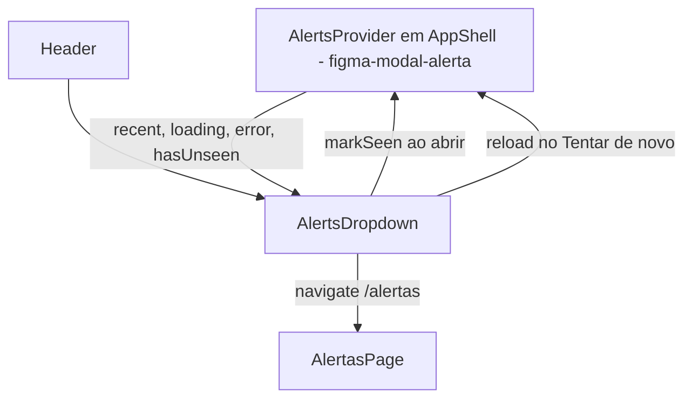

# Dropdown de Alertas Recentes Design

**Spec**: `.specs/features/figma-alertas-dropdown/spec.md`
**Status**: Draft

---

## Architecture Overview

Um componente novo, `AlertsDropdown`, troca o botão do sino em `Header.tsx`. Ele lê o `AlertsContext` (dono: `figma-modal-alerta`) e não chama API. O popover copia o padrão do popover de idioma do próprio Header: âncora `position: relative`, estado `open` local, `Esc` e `mousedown` fora fecham.



**Dependência externa:** a task do `figma-modal-alerta` que cria `Frontend/src/context/AlertsContext.tsx` e monta o provider no `AppShell` (`Frontend/src/App.tsx:10-37`) precisa estar pronta antes da Phase 2. Este plano não cria nem altera esse arquivo.

---

## Code Reuse Analysis

### Existing Components to Leverage

| Component | Location | How to Use |
| --------- | -------- | ---------- |
| Popover de idioma (âncora, `Esc`, clique fora) | `Frontend/src/components/layout/Header.tsx:35-53,60-110` | Mesmo padrão de efeito e marcação (`role="dialog"`, `aria-expanded`). |
| Estilos do popover | `Frontend/src/components/layout/Header.module.css` (`.popoverAnchor`, `.popover`, `.popoverHeader`, `.popoverClose`, `.iconButton`, `@keyframes popover-in`) | O `AlertsDropdown.module.css` repete só o que muda (largura 244 px, linhas, ponto). As classes do Header não são importadas por outro módulo para não acoplar os CSS. |
| Tokens | `Frontend/src/index.css` (`--red`, `--blue`, `--line`, `--fs-sm`, `--fs-xs`, `--radius-sm`, `--shadow`) | Cor do nome (`--red`), título e "Mais" (`--blue`), separadores (`--line`). |
| Ícones | `lucide-react` (`Bell`, `X`, `ChevronRight`) | Já usado no Header. |
| `Incidente` | `Frontend/src/services/incidentService.ts:4-14` | Tipo dos itens de `recent`. |
| Teste do Header | `Frontend/src/test/components/layout/Header.test.tsx` | Ganha um wrapper com `AlertsContext.Provider`; o teste existente de `/notificações/i` continua valendo. |
| Paridade de locales | `Frontend/src/test/config/i18n.test.ts:80-89` | Já falha se um locale não tiver o bloco `alertsDropdown`. |

### Integration Points

| System | Integration Method |
| ------ | ------------------ |
| `AlertsContext` | `useAlerts()` devolve `AlertsContextValue` (contrato em `.specs/features/telas-figma-faltantes/contexto.md`). |
| Roteador | `useNavigate()` para `/alertas` (rota existe em `Frontend/src/routes/appRoutes.tsx`). |
| i18n | `useTranslation()`, chaves `alertsDropdown.*`. |

---

## Components

### AlertsDropdown

- **Purpose**: Sino com ponto de não vistos e popover "Alertas Recentes".
- **Location**: `Frontend/src/components/layout/AlertsDropdown.tsx` + `AlertsDropdown.module.css`
- **Interfaces**:
  - `AlertsDropdown(): JSX.Element` - sem props.
- **Estado local**: `open: boolean`; refs `anchorRef` (clique fora) e `bellRef` (retorno de foco).
- **Comportamento**:
  - `toggle()`: abre ou fecha. Ao abrir, chama `markSeen()` uma vez (ALR-05). O efeito de abrir não depende de `recent`, então chegar item novo com o popover aberto não chama `markSeen()` de novo.
  - `close({ restoreFocus })`: fecha; X e Esc passam `restoreFocus: true` e fazem `bellRef.current?.focus()` (ALR-08).
  - `go()`: `close()` + `navigate('/alertas')` (ALR-02), usado pelo título, pelas linhas e pelo "Mais".
  - Corpo, em ordem de prioridade: `error` → mensagem + "Tentar de novo" (`reload()`); `loading && recent.length === 0` → "Carregando alertas…"; `recent.length === 0` → "Nenhum alerta recente"; senão `recent.slice(0, 5)`.
  - Linha: `<button>` com `incidente.maquina?.nome ?? t('alertsDropdown.unknownMachine')` em `--red`, `ChevronRight` à direita, `key={incidente._id}`.
  - Sino: `aria-label` = `t(hasUnseen ? 'alertsDropdown.bellUnseen' : 'alertsDropdown.bell')`, `aria-expanded={open}`, `aria-haspopup="dialog"`; ponto `<span aria-hidden>` quando `hasUnseen`; classe ativa (fundo cinza do Figma) quando `open`.
- **Dependencies**: `useAlerts`, `useNavigate`, `useTranslation`.
- **Reuses**: padrão do popover de idioma.

### Visual (medido no PNG a 1440 px)

| Elemento | Valor |
| -------- | ----- |
| Popover | 244 px de largura, borda `--border`, raio `--radius-lg`, sombra `--shadow`, `right: 0`, `top: calc(100% + 8px)`, padding 0 (as linhas vão de borda a borda). |
| Cabeçalho | Altura ~40 px, padding 0 16 px; título `--fs-sm` em `--blue` com `ChevronRight` 12 px; X 16 px à direita. |
| Linha | Altura ~31 px, padding 0 16 px, `border-top: 1px solid var(--line)`, texto `--fs-xs` em `--red`, uma linha com `text-overflow: ellipsis`, `ChevronRight` 12 px em `--text`. |
| Rodapé | `border-top` `--line`, padding 8 px; botão "Mais" centralizado, ~44×14 px, fundo `--blue`, texto branco `--fs-xs`, raio 2 px. |
| Ponto | 8 px, `--red`, círculo, canto superior direito do sino, com anel `--bg` de 2 px. |
| Sino aberto | Fundo `--line` (cinza do Figma). |
| Movimento | Reusa `popover-in` 180 ms; `prefers-reduced-motion` já é tratado em `index.css:111`. |

---

## Data Models

Nenhum novo. Consome:

```typescript
// Frontend/src/context/AlertsContext.tsx (figma-modal-alerta)
interface AlertsContextValue {
  recent: Incidente[]; loading: boolean; error: boolean; hasUnseen: boolean
  markSeen(): void; reload(): void; simulate(): void
}
```

Chaves novas (`alertsDropdown`), valores pt-BR:

```json
"alertsDropdown": {
  "bell": "Notificações",
  "bellUnseen": "Notificações (há alertas novos)",
  "title": "Alertas Recentes",
  "close": "Fechar alertas recentes",
  "more": "Mais",
  "loading": "Carregando alertas…",
  "empty": "Nenhum alerta recente",
  "error": "Não foi possível carregar os alertas",
  "retry": "Tentar de novo",
  "unknownMachine": "Máquina não informada"
}
```

---

## Error Handling Strategy

| Error Scenario | Handling | User Impact |
| -------------- | -------- | ----------- |
| `error` do contexto verdadeiro | Corpo troca a lista pela mensagem e "Tentar de novo" → `reload()`. | Vê o erro em vez de lista vazia ou velha. |
| `maquina` nula | Texto "Máquina não informada". | Linha legível, ainda leva a `/alertas`. |
| Contexto ausente (render fora do provider) | Comportamento definido por `useAlerts` do `figma-modal-alerta`. Testes sempre usam o provider. | Nenhum em produção: Header só existe dentro do `AppShell`. |

---

## Risks & Concerns

| Concern | Location (file:line) | Impact | Mitigation |
| ------- | -------------------- | ------ | ---------- |
| `Header.tsx` é editado também por `figma-perfil-admin` (avatar) | `Frontend/src/components/layout/Header.tsx:112-118` | Conflito de merge no nível 1. | Este plano troca só as linhas do sino (`112-114`) por `<AlertsDropdown />` e um import; perfil termina antes. |
| Testes do Header renderizam sem provider | `Frontend/src/test/components/layout/Header.test.tsx:6-12` | Se `useAlerts` lançar fora do provider, os 5+ testes atuais quebram. | T3 envolve o `renderHeaderAt` com `AlertsContext.Provider` de valor fixo. |
| `App.test.tsx` renderiza o shell | `Frontend/src/test/App.test.tsx` | Depende do provider que `figma-modal-alerta` monta. | Pré-requisito da Phase 2; nada a fazer aqui. |
| Nome do hook diverge do assumido | `Frontend/src/context/AlertsContext.tsx` (ainda não existe) | Imports quebrados. | Ajustar só os imports; o contrato da interface é fixo. |

---

## Tech Decisions (only non-obvious ones)

| Decision | Choice | Rationale |
| -------- | ------ | --------- |
| Componente separado vs. inline no Header | `AlertsDropdown.tsx` separado | Header já tem 134 linhas e outro popover; separar reduz o conflito com `figma-perfil-admin` a 2 linhas. |
| CSS próprio vs. reusar classes do Header | `AlertsDropdown.module.css` próprio | Importar `Header.module.css` em outro componente acopla dois arquivos disputados. |
| Linha como `<button>` vs. `<Link>` | `<button>` + `navigate` | Precisa fechar o popover junto; mesmo padrão das opções de idioma. |
| `markSeen()` no clique de abrir, não em efeito | Chamado em `toggle()` | Garante uma chamada por abertura, sem depender de `recent` mudar (edge case 4). |
