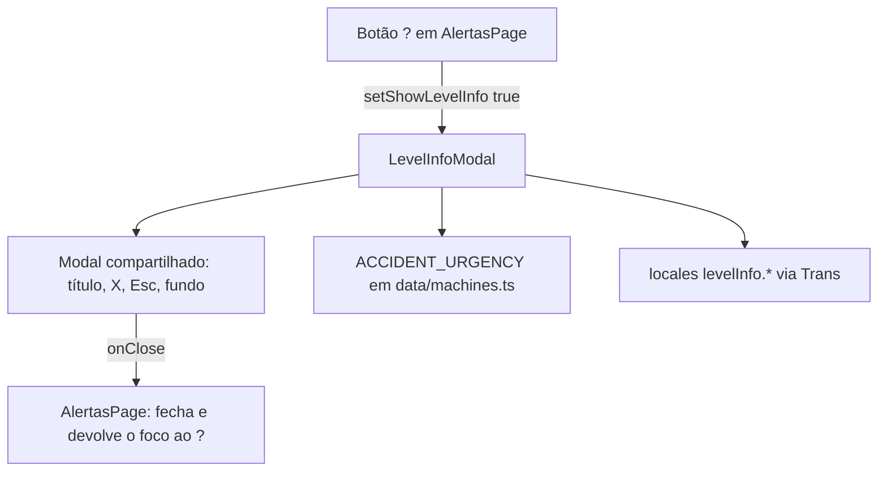

# Modal de explicação de nível crítico Design

**Spec**: `.specs/features/figma-explicacao-nivel/spec.md`
**Status**: Draft

---

## Architecture Overview

Um componente novo de apresentação (`LevelInfoModal`) sobre o `Modal` compartilhado e um botão na barra de `AlertasPage` que o abre. Sem estado global, sem serviço, sem rota.



Conformidade com `.specs/STATE.md`: AD-006 (todo texto em i18n nos 7 locales) e AD-004/AD-007 (padrão de modal e affordances) seguidos; nenhuma decisão ativa é contrariada.

---

## Code Reuse Analysis

### Existing Components to Leverage

| Component | Location | How to Use |
| --------- | -------- | ---------- |
| `Modal` | `Frontend/src/components/common/Modal.tsx` | Título, X, Esc e clique no fundo já prontos (EXP-06). Usado sem mudança. |
| `ACCIDENT_URGENCY`, `UrgencyLevel`, `AccidentCause` | `Frontend/src/data/machines.ts:240-247` | Fonte da causa de cada nível (EXP-03, EXP-05). |
| Tokens `--urgency-critical/high/medium`, `--blue`, `--white`, `--line`, `--radius-sm`, `--fs-*` | `Frontend/src/index.css` | Cores dos cartões e do botão (EXP-04, EXP-09). Os mesmos tokens do cabeçalho do `FleetCard`. |
| `Trans` com `components={{ b: <strong /> }}` | padrão de `pages/LoginPage.tsx:84` | Causa em negrito dentro da frase traduzida, sem quebrar a ordem das palavras de cada língua. |
| `CircleHelp` | `lucide-react` (instalado) | Ícone do "?". |
| Padrão de modal de informação | `components/team/SectorInfoModal.tsx` | Mesma forma: props `onClose`, só conteúdo dentro de `Modal`. |

### Integration Points

| System | Integration Method |
| ------ | ------------------ |
| `AlertasPage` | Estado local `showLevelInfo` + `ref` do botão; render condicional de `LevelInfoModal`. |
| Locales (arquivo disputado) | Só acrescenta o bloco top-level `levelInfo` nos 7 `translation.json`; nenhuma chave existente muda. O teste de paridade de chaves top-level (`test/config/i18n.test.ts`) passa a exigir o bloco nos 7. |

---

## Components

### LevelInfoModal

- **Purpose**: Mostrar os 3 níveis de urgência com a causa de cada um.
- **Location**: `Frontend/src/components/alerts/LevelInfoModal.tsx` + `LevelInfoModal.module.css`
- **Interfaces**:
  - `LevelInfoModal({ onClose }: { onClose: () => void }): JSX.Element`
  - Constante interna `LEVEL_ORDER: UrgencyLevel[] = ['critica', 'alta', 'media']`
  - Causa de um nível: `(Object.keys(ACCIDENT_URGENCY) as AccidentCause[]).find((c) => ACCIDENT_URGENCY[c] === level)`; nível sem causa é pulado (EXP-05).
  - Mapa interno `TONE: Record<UrgencyLevel, string>` → classes `.critical`, `.high`, `.medium` (mesmo formato de `URGENCY_TONE` em `FleetCard.tsx:34`).
- **Markup**: `<Modal title={t('levelInfo.title')}>` → `<ul className={styles.list}>` → por nível `<li className={cx(styles.card, TONE[level])} data-level={level}>` com `<h3 className={styles.level}>{t('levelInfo.level.' + level)}</h3>` e `<p className={styles.text}><Trans i18nKey={'levelInfo.description.' + causa} components={{ b: <strong /> }} /></p>`.
- **Estilo (PNG)**: lista em coluna, `gap: 24px`. Cartão: `border: 1px solid var(--line)`, `border-radius: 8px`, `border-left: 20px solid var(--tone)`, `padding: 20px 16px`, texto centralizado. Título do nível `font-size: 16px`, `font-weight: 500`, `color: var(--tone)`. Descrição `font-size: var(--fs-md)`, cor `--text`, `<strong>` em 600. Cada classe de tom define só `--tone: var(--urgency-*)`, que a faixa e o título leem.
- **Dependencies**: `react-i18next`, `Modal`, `data/machines`.
- **Reuses**: tudo da tabela acima.

### AlertasPage (alteração)

- **Purpose**: Botão "?" que abre o modal.
- **Location**: `Frontend/src/pages/AlertasPage.tsx` + `AlertasPage.module.css`
- **Mudanças**:
  - `const [showLevelInfo, setShowLevelInfo] = useState(false)` e `const helpRef = useRef<HTMLButtonElement>(null)`.
  - Primeiro filho de `.filters`: `<button type="button" ref={helpRef} className={styles.helpButton} aria-label={t('levelInfo.open')} title={t('levelInfo.open')} onClick={() => setShowLevelInfo(true)}><CircleHelp size={16} aria-hidden="true" /></button>`.
  - `{showLevelInfo && <LevelInfoModal onClose={closeLevelInfo} />}` ao lado do `MachineDetailModal`; `closeLevelInfo` faz `setShowLevelInfo(false)` e `helpRef.current?.focus()` (EXP-07).
  - O botão fica na barra fora do ramo de skeleton, então aparece com lista vazia (EXP-10) e não aparece no skeleton.
- **CSS** `.helpButton`: `display: inline-flex; align-items: center; justify-content: center; width: 56px; height: 32px; border: 0; border-radius: var(--radius-sm); background: var(--blue); color: var(--white); cursor: pointer;` + `:focus-visible` com `outline: 2px solid var(--blue); outline-offset: 2px`. Altura 32 px igual à busca (`.searchInput`).

---

## Data Models

Só texto de locale. Valores pt-BR (os outros 6 locales traduzem a mesma estrutura):

```json
"levelInfo": {
  "title": "Informações sobre nível crítico",
  "open": "Sobre os níveis de urgência",
  "level": { "critica": "Crítico", "alta": "Alta", "media": "Média" },
  "description": {
    "tombamento": "Nível de urgência crítico associado a um <b>tombamento</b>.",
    "colisao": "Nível de urgência crítico associado a uma <b>colisão</b>.",
    "frenagem": "Nível de urgência crítico associado a uma <b>frenagem brusca</b>."
  }
}
```

As chaves de descrição são por causa (não por nível), porque o artigo ("um"/"uma") e o negrito dependem da causa, e o mapa causa → nível pode mudar.

---

## Error Handling Strategy

| Error Scenario | Handling | User Impact |
| -------------- | -------- | ----------- |
| Nível sem causa em `ACCIDENT_URGENCY` | Cartão omitido (EXP-05) | Modal com menos cartões, sem texto falso |
| Chave ausente num locale | `fallbackLng: 'pt-BR'` já existente | Texto em pt-BR; o teste de chaves (T1) impede que isso chegue ao merge |

---

## Risks & Concerns

| Concern | Mitigation |
| ------- | ---------- |
| `translation.json` é disputado por 7 features | Só acrescentar o bloco `levelInfo` no fim do objeto raiz; nenhuma linha existente muda além da vírgula do bloco anterior. O nível 1 faz o merge. |
| `Modal` não devolve o foco ao fechar (gap de acessibilidade compartilhado) | Devolução feita no chamador (`AlertasPage`), sem tocar em `Modal.tsx`, para não conflitar com as outras features. |
| `Modal` 550 px vs Figma 458 px | Aceito e registrado na spec; se o dono pedir, uma prop `className` no `Modal` resolve depois da integração. |
| Erro de carga em `AlertasPage` vira lista vazia (auditoria) | Fora de escopo; o botão funciona nos dois casos (EXP-10). |

---

## Tech Decisions

| Decision | Choice | Rationale |
| -------- | ------ | --------- |
| Onde mora o componente | `components/alerts/` (pasta nova) | O modal é da tela de alertas; `figma-alertas-dropdown` usa o mesmo namespace de pasta se precisar. |
| Lazy load | Não | Componente de poucas linhas dentro de `AlertasPage`, que já é chunk de rota. |
| Ordem dos níveis | Constante `LEVEL_ORDER` no componente | Ordem é de apresentação (Figma), não de domínio. |
