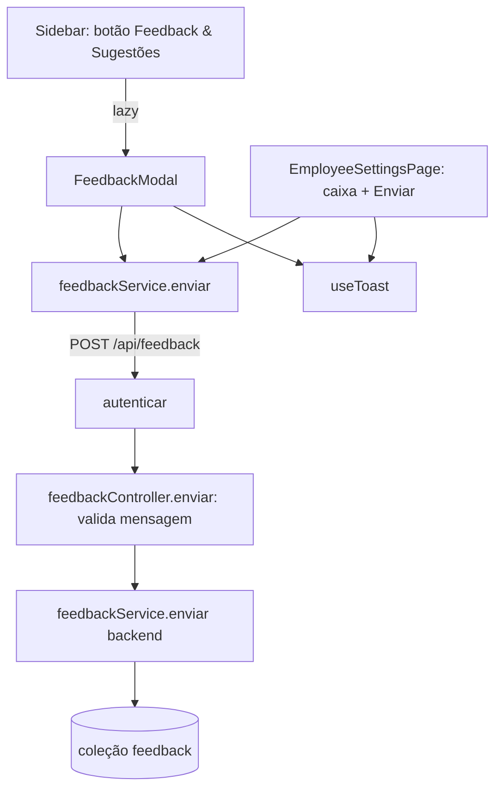

# Feedback e Sugestões Design

**Spec**: `.specs/features/figma-feedback/spec.md`
**Status**: Draft

---

## Architecture Overview

Uma rota nova atrás do `autenticar`, no mesmo formato das features existentes (schema → service → controller → router). No front, um serviço de uma função usado por dois lugares: o modal novo aberto pela sidebar e a caixa já existente em Configurações do funcionário.



Dados vêm do token: `req.usuario` (`_id`, `role`) e `req.escopo.empresaId`, ambos já preenchidos pelo `autenticar` (`Backend/src/core/autenticar.ts:36-37`). O corpo só contribui com `mensagem`.

---

## Code Reuse Analysis

### Existing Components to Leverage

| Component | Location | How to Use |
| --------- | -------- | ---------- |
| `autenticar` | `Backend/src/core/autenticar.ts` | Já cobre o 401 para tudo montado depois de `app.use('/api', autenticar)`; a rota entra depois dessa linha. |
| `ErroHttp`, `StatusCode`, `respostaSucesso`, `responderErro` | `Backend/src/utils/responseHandler.ts` | Mesmo tratamento de erro do `incidentController`. |
| Validação no controller | `Backend/src/feature/incident/incidentController.ts:8-24` (`lerOcorrencia`) | Mesmo padrão: função `lerMensagem(req)` que lança `ErroHttp(400)`. |
| Teste de schema sem banco | `Backend/tests/unit/schemas.test.ts` | Mock de `conn` + `validate()`. |
| Teste de app sem banco | `Backend/tests/unit/app.test.ts` | Servidor real na porta 0 com `User`/`Branch` mockados; acrescenta o caso 401 de `/api/feedback`. |
| `Modal` | `Frontend/src/components/common/Modal.tsx` | Título, X, Esc e clique no fundo já resolvidos. |
| `DialogButtons.module.css` (`.confirm`) | `Frontend/src/components/common/DialogButtons.module.css` | Botão azul "Enviar" (mesmo estilo do `CategoryFormModal`). |
| `useToast` | `Frontend/src/components/common/Toast.tsx` | `show` / `showError`; o `ToastProvider` envolve o app inteiro em `main.tsx`, inclusive a área do funcionário. |
| `api` | `Frontend/src/services/api.ts` | Axios com token e interceptor de 401. |
| `lazy` + `Suspense` | `Frontend/src/routes/appRoutes.tsx:1-6` | Mesmo recurso para o modal não entrar no bundle de entrada. |
| Estilo do textarea | `Frontend/src/pages/employee/EmployeeSettingsPage.module.css:63-92` | O modal copia os valores (borda `--line`, fundo `--gray-bg`, placeholder `--text-muted`). |

### Integration Points

| System | Integration Method |
| ------ | ------------------ |
| `Backend/src/app.ts` | Uma linha: `app.use('/api/feedback', feedbackRouter);` junto das outras rotas autenticadas (arquivo disputado com `figma-perfil-admin`; só esta linha e o import). |
| MongoDB | Coleção nova `feedback`, sem relação obrigatória com as outras além das refs `user` e `company`. |
| `Sidebar.tsx` | Só o trecho do botão de feedback (`:219-230`) e um estado local; o resto do arquivo é de `figma-dashboard` e `figma-modal-alerta`. |
| Locales | Bloco novo `feedback.*` e a chave `employee.settings.feedbackPlaceholder`; nenhuma chave existente muda. |

---

## Components

### Schema `Feedback`

- **Purpose**: Guardar cada mensagem enviada.
- **Location**: `Backend/src/schemas/feedback.ts`
- **Interfaces**: `export const Feedback = conn.mongoose.model('feedback', feedbackSchema)`
- **Dependencies**: `conn`
- **Reuses**: formato de `Backend/src/schemas/incident.ts`

### `feedbackService.enviar` (backend)

- **Purpose**: Criar o documento com os dados do usuário autenticado.
- **Location**: `Backend/src/feature/feedback/feedbackService.ts`
- **Interfaces**:
  - `enviar(usuario: UsuarioRequisicao, escopo: Escopo, mensagem: string): Promise<{ _id: string; criadoEm: string }>` - grava `{ mensagem, usuarioId: usuario._id, empresaId: escopo.empresaId ?? null, role: usuario.role }` e devolve o id e a data ISO.
- **Dependencies**: `Feedback`
- **Reuses**: tipos de `core/autenticar.ts` e `core/escopo.ts`

### `feedbackController.enviar`

- **Purpose**: Validar o corpo e responder.
- **Location**: `Backend/src/feature/feedback/feedbackController.ts`
- **Interfaces**:
  - `enviar(req, res)` - lê `req.body.mensagem`; se não for `string` ou se `trim()` tiver 0 ou mais de 1000 caracteres, lança `ErroHttp(400, "O campo 'mensagem' deve ter de 1 a 1000 caracteres.")`; senão chama o service com a mensagem cortada e responde 201.
- **Dependencies**: service, `responseHandler`
- **Reuses**: padrão de `incidentController.ts`

### `feedbackRouter`

- **Purpose**: `router.post('/', enviar)`.
- **Location**: `Backend/src/feature/feedback/feedbackRouter.ts`

### `feedbackService` (front)

- **Purpose**: Contrato compartilhado do front.
- **Location**: `Frontend/src/services/feedbackService.ts`
- **Interfaces**:
  - `feedbackService.enviar(mensagem: string): Promise<void>` - `api.post('/feedback', { mensagem })`.
- **Reuses**: `api`

### `FeedbackModal`

- **Purpose**: O modal do Figma `06/01`.
- **Location**: `Frontend/src/components/feedback/FeedbackModal.tsx` (+ `FeedbackModal.module.css`)
- **Interfaces**: `FeedbackModal({ onClose }: { onClose: () => void })` (export default, para o `lazy`)
- **Comportamento**:
  - Estado `texto` e `enviando`. `valida = texto.trim().length > 0`.
  - `<Modal title={t('feedback.title')} onClose={onClose}>` com `<form onSubmit>`: `<label htmlFor>` "Como foi sua experiência?", `<textarea autoFocus maxLength={1000}>`, botão `type="submit"` com `className={buttons.confirm}` e `disabled={!valida || enviando}`.
  - Submit: `if (!valida || enviando) return`; `enviando = true`; `await feedbackService.enviar(texto.trim())`; sucesso → `show(t('feedback.sent'))` e `onClose()`; erro → `showError(t('feedback.error'))` e `enviando = false` (texto fica).
  - Fechar pelo X/Esc/fundo é o próprio `Modal`.
- **Dependencies**: `Modal`, `useToast`, `feedbackService`, i18n
- **Reuses**: `Modal`, `DialogButtons.module.css`

### Sidebar (trecho do botão)

- **Change**: `const FeedbackModal = lazy(() => import('../feedback/FeedbackModal'))`; estado `feedbackOpen`; `onClick={() => { closeMobileDrawer(); setFeedbackOpen(true) }}`; depois do `<nav>`: `{feedbackOpen && <Suspense fallback={null}><FeedbackModal onClose={() => setFeedbackOpen(false)} /></Suspense>}`.
- **Location**: `Frontend/src/components/layout/Sidebar.tsx`

### EmployeeSettingsPage (seção de feedback)

- **Change**: textarea vira controlado (`texto`, `maxLength={1000}`), entra botão "Enviar" (`t('feedback.send')`) abaixo, alinhado à direita, com a mesma regra de `disabled` e o mesmo fluxo do modal; no sucesso limpa `texto` em vez de fechar.
- **Location**: `Frontend/src/pages/employee/EmployeeSettingsPage.tsx` (+ `.send` em `EmployeeSettingsPage.module.css`)
- **Reuses**: `feedbackService`, `useToast`, chaves `feedback.send|sent|error`

> A lógica de envio se repete nos dois lugares (≈10 linhas). Um hook compartilhado só vale quando houver um terceiro lugar.

---

## Data Models

### Feedback

```typescript
// Backend/src/schemas/feedback.ts
const feedbackSchema = new Schema({
  mensagem: { type: String, required: true, trim: true, maxlength: 1000 },
  usuarioId: { type: ObjectId, ref: 'user', required: true },
  empresaId: { type: ObjectId, ref: 'company' },   // nulo para usuário legado sem empresa
  role: { type: String, required: true },
  criadoEm: { type: Date, default: Date.now },
})
```

**Relationships**: `usuarioId` → `user`, `empresaId` → `company`. Sem índice: não há leitura pela aplicação (o dono consulta direto).

### Textos (pt-BR; os outros 6 locales recebem a tradução)

```json
"feedback": {
  "title": "Envie-nos feedback ou uma sugestão",
  "question": "Como foi sua experiência?",
  "placeholder": "Digite uma sugestão de melhoria ou um feedback!",
  "send": "Enviar",
  "sent": "Feedback enviado. Obrigado!",
  "error": "Não foi possível enviar o feedback. Tente de novo."
}
```

E em `employee.settings`: `"feedbackPlaceholder": "Digite uma sugestão de melhoria ou um feedback!"`.

---

## Error Handling Strategy

| Error Scenario | Handling | User Impact |
| -------------- | -------- | ----------- |
| Mensagem inválida no servidor | 400 com mensagem fixa, nada gravado | Não acontece pela UI (botão desabilitado e `maxLength`); só por chamada direta. |
| Sem token / token inválido | 401 do `autenticar` | Interceptor do `api.ts` desloga e manda para `/login`. |
| Falha de rede ou 500 | `responderErro` → 500; front cai no `catch` | Toast de erro; o texto continua na tela para tentar de novo. |

---

## Tech Decisions

| Decision | Choice | Rationale |
| -------- | ------ | --------- |
| Validação | No controller, à mão, como `incidentController` | O projeto não usa biblioteca de validação; o schema tem `maxlength` como segunda barreira. |
| Modal lazy | `React.lazy` no próprio `Sidebar` | Mantém o bundle de entrada (meta do contexto: ≤ 100 kB gzip). |
| Largura do modal | `Modal` sem mudança (máx. 550 px) | Ver Assumptions da spec. |
| Sem hook compartilhado de envio | Lógica duplicada em 2 componentes | Duas cópias pequenas custam menos que uma abstração nova. |
