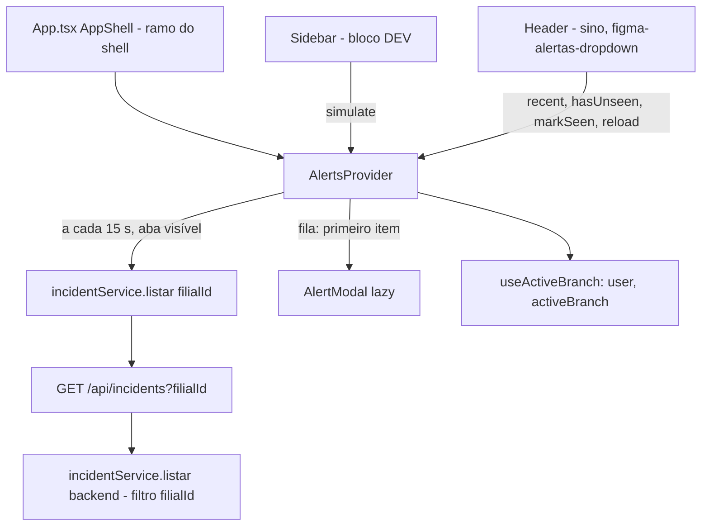

# Modal "Alerta!" e contexto de alertas Design

**Spec**: `.specs/features/figma-modal-alerta/spec.md`
**Status**: Draft

---

## Architecture Overview

Um provider (`AlertsProvider`) montado só no ramo do shell do admin em `App.tsx` faz o polling de `GET /api/incidents?filialId=…`, guarda a linha de base e a fila em memória, expõe o contrato `AlertsContextValue` e renderiza o `AlertModal` (lazy) para o primeiro item da fila. A Sidebar chama `simulate()` pelo botão DEV. O dropdown do sino (`figma-alertas-dropdown`) só lê `recent`/`hasUnseen` e chama `markSeen()`/`reload()`.



Por que o provider só monta no ramo do shell: `AppShell` já devolve `<AppRoutes />` puro para login, solicitações e funcionário (`Frontend/src/App.tsx:12-19`). Montar o provider no outro ramo garante MAL-07 sem checar rota dentro dele, e o logout (que navega para `/login`) desmonta o provider e para o polling.

---

## Code Reuse Analysis

### Existing Components to Leverage

| Component | Location | How to Use |
| --------- | -------- | ---------- |
| `incidentService.listar` + `Incidente` | `Frontend/src/services/incidentService.ts` | Fonte do polling; ganha `filialId?: string` em `FiltroIncidentes` (o axios já repassa `params`). |
| `useActiveBranch` | `Frontend/src/context/ActiveBranchContext.tsx` | `user` (sem usuário não consulta; `user._id` na chave do `localStorage`) e `activeBranch` (`'todas'` → sem `filialId`), igual a `VisaoGeralPage.tsx:46-47`. |
| Backdrop do `Modal` | `Frontend/src/components/common/Modal.module.css` (`.backdrop`, `@keyframes`) | `AlertModal.module.css` usa `composes: backdrop from '../common/Modal.module.css'`. O `Modal` em si não serve: tem X, título à esquerda e fecha no clique de fundo. |
| Botão azul | `Frontend/src/components/common/DialogButtons.module.css` (`.confirm`) | Botão "Ok" (`composes: confirm from …`), largura do Figma (~170 px). |
| Tokens | `Frontend/src/index.css` (`--danger-solid`, `--blue`, `--bg`, `--border`, `--text`, `--text-h`, `--fs-*`) | Círculo e título em `--danger-solid` (#ef4444, preenchimento; o vermelho do PNG é esse tom, não `--red #ff0000`). |
| `Trans` do react-i18next | já usado em `Frontend/src/pages/LoginPage.tsx` | Texto com `<b>` no setor e no funcionário. |
| Leitura/escrita segura de storage | padrão `readStored`/`writeStored` com try/catch em `ActiveBranchContext.tsx` e `Sidebar.tsx` | Mesmo padrão para `liftech.alerts.seen.<userId>`. |
| `AlertTriangle` (lucide-react) | já importado em `AlertasPage.tsx` | Ícone do círculo vermelho. |
| Filtro por filial no backend | `listarMaquinas` em `Backend/src/feature/machine/machineService.ts:78-81` e `lerMachineId` em `Backend/src/feature/session/sessionService.ts:25-31` | Mesma interseção com o escopo e a mesma validação de ObjectId (400). |

### Integration Points

| System | Integration Method |
| ------ | ------------------ |
| `GET /api/incidents` | Query `filialId` opcional, tratada em `incidentService.listar` (backend). Sem mudança de rota nem de controller (`req.query` já chega inteiro). |
| `App.tsx` (arquivo disputado com `figma-splash`) | Só envolve o `<div className="app-shell">` com `<AlertsProvider>`. |
| `Sidebar.tsx` (disputado com dashboard e feedback) | Só acrescenta um botão dentro do bloco `DEV: Telas de auth`, depois do `.map` de `TEMP_AUTH_LINKS`. |
| Locales (7) | Só acrescenta o bloco `alertModal`; `test/config/i18n.test.ts` ganha `'alertModal'` em `REQUIRED_MODULES`. |

---

## Components

### Filtro `filialId` em `listar` (backend)

- **Purpose**: Restringir a lista de incidentes a uma filial do escopo.
- **Location**: `Backend/src/feature/incident/incidentService.ts` (`listar`)
- **Interfaces**:
  - `listar(escopo: Escopo, filtro: FiltroLista & { filialId?: unknown })` — `filialId` ausente ou `''`: todas as filiais do escopo; string ObjectId válida: `filialId: { $in: permitidas.filter(id => id === filialId) }` (fora do escopo vira `$in: []` e devolve `[]`); outro valor: `ErroHttp(400, "O campo 'filialId' deve ser um ObjectId válido do MongoDB.")` antes do `find`.
- **Dependencies**: `filtroPorFilial`, `Types.ObjectId.isValid`.
- **Reuses**: padrão de `listarMaquinas` e `lerMachineId`.

### `incidentService` (front)

- **Purpose**: Mandar `filialId` como query.
- **Location**: `Frontend/src/services/incidentService.ts`
- **Interfaces**: `FiltroIncidentes` ganha `filialId?: string`. `listar` não muda.

### `AlertsContext`

- **Purpose**: Polling, fila do modal, `recent` e marca de vistos do sino.
- **Location**: `Frontend/src/context/AlertsContext.tsx`
- **Interfaces**:
  - `interface AlertsContextValue { recent: Incidente[]; loading: boolean; error: boolean; hasUnseen: boolean; markSeen(): void; reload(): void; simulate(): void }` (contrato fixo)
  - `AlertsProvider: React.FC<{ children: React.ReactNode }>`
  - `useAlerts(): AlertsContextValue` (valor padrão inerte: `recent: []`, funções no-op, para componentes fora do provider em teste)
  - `export const POLL_INTERVAL_MS = 15_000`, `export const SAMPLE_INCIDENT: Incidente` (setor "Expedição - Bloco B", operador "Alexandre Mattos", identificação "EMP-084(ID)"; `_id: 'simulado'`)
- **Estado interno**:
  - `recent`, `loading`, `error` em `useState`.
  - `queue: Incidente[]` em `useState`; o modal mostra `queue[0]`; fechar faz `queue.slice(1)`.
  - `known: Set<string> | null` em `useRef` (linha de base + já alertados). `null` = ainda sem linha de base.
  - `seen: string[]` em `useState`, lido do `localStorage` quando `user._id` muda.
- **Fluxo do polling** (`useEffect` com deps `[userId, filialId]`):
  1. Sem `user`: não faz nada.
  2. Zera `known.current = null`, `loading = true`. Chama `poll()` na hora e agenda `setInterval(poll, POLL_INTERVAL_MS)`; ouve `visibilitychange` e chama `poll()` ao voltar a `visible`.
  3. `poll()`: retorna se `document.visibilityState !== 'visible'`; chama `incidentService.listar({ filialId })`; resposta com `stale` (cleanup rodou) é descartada.
  4. Sucesso: `recent = list.slice(0, 5)`, `error = false`, `loading = false`. Se `known.current === null`, vira `new Set(ids)` (linha de base, sem modal). Senão, `novos = list.filter(i => !known.has(i._id))`, adiciona os ids a `known`, ordena `novos` por `dataIncidente` crescente e faz `setQueue(q => [...q, ...novos])`.
  5. Falha: `error = true`, `loading = false`; `recent`, `queue` e `known` ficam como estão (com `known` nulo, a próxima resposta vira a linha de base).
  6. Cleanup: `stale = true`, `clearInterval`, remove o listener.
- **`reload()`**: chama a `poll` do efeito atual, guardada em `pollRef.current`, ignorando a checagem de visibilidade. Não reinicia o efeito, para não zerar a linha de base: um incidente chegado entre consultas ainda abre o modal.
- **`simulate()`**: `setQueue(q => [...q, SAMPLE_INCIDENT])`, sem API.
- **`hasUnseen`**: `recent.some(i => !seen.includes(i._id))`.
- **`markSeen()`**: `ids = recent.map(i => i._id)`; `setSeen(ids)`; grava `JSON.stringify(ids)` em `liftech.alerts.seen.<userId>` com try/catch. Leitura com try/catch e `JSON.parse` defensivo (não-array → `[]`).
- **Render**: `<Provider>{children}{queue[0] && <Suspense fallback={null}><AlertModal incident={queue[0]} onClose={dismiss} /></Suspense>}</Provider>`, com `AlertModal = lazy(() => import('../components/alerts/AlertModal'))`. O `key={queue[0]._id + tamanho da fila}` não é preciso: o foco vai ao "Ok" num efeito que depende de `incident`.
- **Dependencies**: `useActiveBranch`, `incidentService`.
- **Reuses**: padrão `stale` de `VisaoGeralPage.tsx:58-74`; storage seguro de `ActiveBranchContext.tsx:38-52`.

### `AlertModal`

- **Purpose**: Desenhar o modal do PNG para um incidente.
- **Location**: `Frontend/src/components/alerts/AlertModal.tsx` + `AlertModal.module.css`
- **Interfaces**: `default AlertModal: React.FC<{ incident: Incidente; onClose: () => void }>`
- **Comportamento**:
  - Backdrop sem `onClick` de fechar (MAL-14). Esc chama `onClose` (listener em `window`, como `Modal.tsx:17-24`).
  - Cartão `role="alertdialog"`, `aria-modal="true"`, `aria-labelledby` no `h2`, `aria-describedby` no `p` (ids por `useId`).
  - Foco no "Ok" com `useRef` + `useEffect([incident])` (MAL-13), para o próximo da fila também receber foco.
  - Texto: `<Trans i18nKey="alertModal.message" values={{ setor, funcionario, maquina }} components={{ b: <b /> }} />`, com `naoInformado = t('alertModal.notInformed')` para `maquina?.setor`, `operador?.nome` e `maquina?.identificacao` vazios ou nulos (MAL-05).
- **CSS** (medidas do PNG em 1440 px): cartão `max-width: 470px; width: 100%`, `padding: 32px 40px 26px`, `border-radius: 10px`, `border: 0.5px solid var(--border)`, `background: var(--bg)`, conteúdo centralizado em coluna com `gap: 16px`; círculo 64 px `background: var(--danger-solid)`, ícone branco 24 px; título `font-size: var(--fs-3xl)` (32 px), `color: var(--danger-solid)`, `font-weight: 500`; texto `font-size: var(--fs-lg)`, `color: var(--text)`, `text-align: center`, `overflow-wrap: anywhere` (MAL-16), `<b>` com `font-weight: 600; color: var(--text-h)`; botão "Ok" `min-width: 170px` com `margin-top: 20px`.

### Botão "Simular alerta" (Sidebar)

- **Purpose**: Abrir o modal com o exemplo.
- **Location**: `Frontend/src/components/layout/Sidebar.tsx`, dentro do bloco DEV (já escondido com a sidebar colapsada, MAL-18).
- **Interfaces**: `<button type="button" className={styles.navLink} style={{ fontSize: 12 }} onClick={simulate}>` com ícone `AlertTriangle size={16}` e rótulo "Simular alerta" fixo.
- **Reuses**: estilo dos links de `TEMP_AUTH_LINKS`; `useAlerts().simulate`.

---

## Data Models

Sem modelo novo. O contrato consumido é o `Incidente` já existente:

```typescript
interface Incidente {
  _id: string
  machineId: string
  maquina: { nome: string; identificacao: string; setor: string } | null
  operador: { nome: string } | null
  dataIncidente: string
  forcaImpacto: number | null
  status: string
  origem: 'sensor' | 'funcionario'
  descricao: string | null
}
```

`localStorage['liftech.alerts.seen.<userId>']` = `JSON.stringify(string[])` (até 5 ids).

Bloco de locale (pt-BR; os outros 6 com tradução equivalente e as mesmas tags `<b>`):

```json
"alertModal": {
  "title": "Alerta!",
  "message": "Acidente no setor <b>{{setor}}</b>, <b>{{funcionario}}</b> funcionário responsável pela máquina {{maquina}}.",
  "notInformed": "não informado",
  "ok": "Ok"
}
```

---

## Error Handling Strategy

| Error Scenario | Handling | User Impact |
| -------------- | -------- | ----------- |
| Polling falha (rede, 5xx) | `error = true`; `recent`, fila e linha de base mantidas; tenta no próximo ciclo | Nenhum modal falso; o sino pode mostrar o erro (feature do dropdown) |
| 401 no polling | O interceptor de `api.ts` faz logout e navega a `/login`; o provider desmonta | Vai para o login, como em qualquer rota |
| Resposta após troca de filial/desmontagem | Flag `stale` descarta | Nada |
| `localStorage` bloqueado | try/catch: leitura `[]`, escrita ignorada, `seen` segue em memória | Ponto do sino pode voltar após recarregar |
| `filialId` inválido no backend | 400 antes do `find` | Só por chamada manual; o front manda ids da sessão |
| Incidente sem máquina/operador/setor | "não informado" no trecho | Texto completo, sem `undefined` |

---

## Risks & Concerns

| Concern | Location (file:line) | Impact | Mitigation |
| ------- | -------------------- | ------ | ---------- |
| Polling baixa até 500 incidentes formatados a cada 15 s por admin com a aba aberta | `Backend/src/feature/incident/incidentService.ts` (`listar`, `.limit(LIMITE_HISTORICO)`) | Carga no banco e na rede cresce com o histórico | Aceito agora (`ponytail:` no `AlertsContext`): pausa com a aba oculta. Upgrade: `limit` na rota se a lista passar de algumas centenas. |
| `dataIncidente` do funcionário pode ser anterior à consulta anterior (vem do `horario` informado) | `Backend/src/feature/incident/incidentService.ts` (`reportar`, `setHours`) | Comparação por data perderia o alerta | Linha de base e "novo" por `_id`, não por data. |
| Incidente novo fora dos 500 mais recentes | mesma rota | Não seria alertado | Só acontece com > 500 incidentes com data mais nova que ele; aceito. |
| `App.tsx`, `Sidebar.tsx` e o `i18n.test.ts` são editados por outras features | `Frontend/src/App.tsx:23-31`, `Sidebar.tsx:179-197`, `test/config/i18n.test.ts:20` | Conflito no merge do nível 1 | Cada task toca só o trecho dito em Integration Points. |
| O contexto do Header usa `aria-label` fixos em pt | `Header.tsx` | Não é desta feature | Nenhuma; anotado para `figma-alertas-dropdown`. |
| `setInterval` em teste | testes do contexto | Testes lentos ou instáveis | `vi.useFakeTimers()` + `act(() => vi.advanceTimersByTimeAsync(POLL_INTERVAL_MS))`, como `FrotaPage.test.tsx:353-359`. |

---

## Tech Decisions (only non-obvious ones)

| Decision | Choice | Rationale |
| -------- | ------ | --------- |
| Onde montar o provider | Só no ramo do shell em `AppShell` | Cumpre MAL-07 sem lógica de rota; o logout desmonta. |
| Marca do modal × marca do sino | Modal: `Set` em memória por sessão/filial. Sino: ids em `localStorage` por usuário | Comportamentos distintos (avisar uma vez × "não abri a lista"). |
| "Novo" por `_id` | `!known.has(_id)` | Datas retroativas do funcionário. |
| Filtro por filial | No backend (`filialId` em `GET /api/incidents`) | A resposta não traz `filialId`; filtrar no front exigiria cruzar com `/machines`. |
| `reload()` | Consulta na hora sem refazer a linha de base | Um incidente chegado entre consultas ainda abre o modal. |
| Modal próprio em vez de `Modal` com variante | `AlertModal` com `composes` do backdrop | `Modal` tem X, título à esquerda e fecha no fundo; uma variante mudaria um componente usado em 10+ telas. |
| Lazy | `React.lazy` no `AlertModal` | Meta de bundle ≤ 100 kB do contexto compartilhado. |
