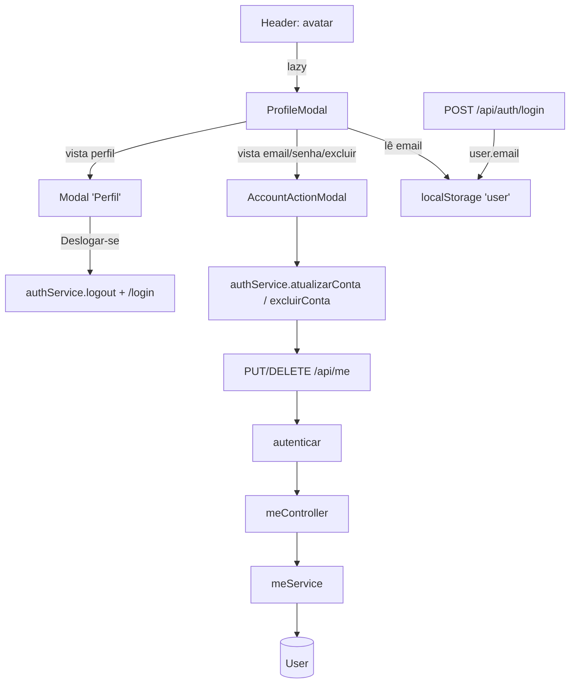

# Perfil do admin Design

**Spec**: `.specs/features/figma-perfil-admin/spec.md`
**Status**: Draft

---

## Architecture Overview

Duas rotas novas no backend, numa feature `me` com o mesmo formato de `auth` (funções de serviço que usam o schema `User` direto, controller fino, router). No frontend, o avatar do `Header` abre um `ProfileModal` carregado sob demanda; ele alterna entre a vista "Perfil" e uma vista de ação (e-mail, senha, excluir) dentro do mesmo componente pai, então só um `Modal` existe na tela por vez.



---

## Code Reuse Analysis

### Existing Components to Leverage

| Component | Location | How to Use |
| --------- | -------- | ---------- |
| `autenticar` + `exigirAdmin` | `Backend/src/core/autenticar.ts:27-50` | Middleware já protege `/api/*`; `exigirAdmin(req.usuario, ...)` dá o 403 do colaborador. |
| `verificarSenha`, `gerarHashSenha` | `Backend/src/utils/senha.ts` | Conferir a senha atual e gravar a nova. |
| `ErroHttp`, `responderErro`, `StatusCode` | `Backend/src/utils/responseHandler.ts` | Status de erro saem do serviço; controller só repassa. |
| `exigirSemOperadores` | `Backend/src/utils/corpo.ts` | Recusar chaves `$` no corpo. |
| Regra de e-mail (regex) | `Backend/src/feature/accessRequest/accessRequestRules.ts:14-16` | Copiar a regex para uma constante exportada de `meService` (ver Tech Decisions). |
| Padrão 11000 → 409 | `Backend/src/feature/branch/branchService.ts:14-16` | Mesma forma para e-mail repetido. |
| Teste de controller com `res` mockado | `Backend/tests/unit/sessionController.test.ts` | Mesmo molde de `req`/`res`/`respondeu`. |
| Teste de serviço com `User` mockado | `Backend/tests/unit/authService.test.ts:12-34` | Mesmo `vi.mock` do schema e `mockarBusca` com `select().lean()`. |
| Teste HTTP pelo `app` | `Backend/tests/unit/app.test.ts` | Um caso para `/api/me` sem token (401) e montagem da rota. |
| `Modal` | `Frontend/src/components/common/Modal.tsx` | Título, X, Esc, clique no fundo. |
| `DialogButtons.module.css`, `TeamForm.module.css` | `Frontend/src/components/common/`, `components/team/` | Botões Cancelar/Confirmar e campos de formulário, como em `InitialPasswordModal.tsx`. |
| `useToast` | `Frontend/src/components/common/Toast.tsx` | Toasts "E-mail alterado", "Senha alterada" e erro genérico. |
| `authService` | `Frontend/src/services/authService.ts` | Ganha `email` em `UsuarioLogado` e as funções de conta; já cuida da sessão local. |
| Teste do `authService` | `Frontend/src/test/services/authService.test.ts` | Mesmo mock de `api`. |
| Teste do `Header` | `Frontend/src/test/components/layout/Header.test.tsx` | Acrescentar o caso do avatar. |

### Integration Points

| System | Integration Method |
| ------ | ------------------ |
| `Backend/src/app.ts` | Uma linha: `app.use('/api/me', meRouter)` depois de `app.use('/api', autenticar)`. Arquivo disputado com `figma-feedback` (uma linha cada). |
| `POST /api/auth/login` | `authService.login` acrescenta `email: usuario.email` ao `user`. Para colaborador, `email` fica `undefined` e some do JSON. |
| `Frontend/src/components/layout/Header.tsx` | Só o botão do avatar ganha `onClick` e o `ProfileModal` lazy. Disputado com `figma-alertas-dropdown` (sino); Perfil termina antes. |
| Locales | Bloco novo `profile.*` nos 7 `translation.json`, sem tocar chaves existentes. |
| `User` (Mongo) | `findById(...).select('+senhaHash').lean()`, `updateOne`, `countDocuments`, `deleteOne`. Índice único de `email` já existe (`schemas/user.ts:9`). |

---

## Components

### meService (Backend)

- **Purpose**: Regras de conta do próprio usuário: validar corpo, conferir senha, atualizar e excluir.
- **Location**: `Backend/src/feature/me/meService.ts`
- **Interfaces**:
  - `validarAtualizacao(corpo: unknown): { senhaAtual: string; email?: string; novaSenha?: string }` - 400 (`ErroHttp`) para chave fora de `senhaAtual|email|novaSenha`, chave `$`, nenhum de `email`/`novaSenha`, `senhaAtual` vazia/não texto, e-mail fora da regex, `novaSenha` com menos de 8 caracteres ou não texto. Devolve o e-mail já com `trim().toLowerCase()`.
  - `validarExclusao(corpo: unknown): { senhaAtual: string }` - 400 para `senhaAtual` vazia ou não texto.
  - `atualizarConta(usuario: UsuarioRequisicao, dados): Promise<{ email: string }>` - `exigirAdmin` (403) → lê com `+senhaHash` (404 se sumiu) → `verificarSenha` (403 "Senha atual incorreta.") → `updateOne({ _id }, { $set })` com `email` e/ou `senhaHash: gerarHashSenha(novaSenha)` → 11000 vira 409 "E-mail já em uso." → devolve `{ email }` (o novo ou o atual).
  - `excluirConta(usuario: UsuarioRequisicao, empresaId: string | undefined, senhaAtual: string): Promise<void>` - `exigirAdmin` → lê e confere senha como acima → se `!empresaId` ou `countDocuments({ empresaId, role: 'admin', _id: { $ne }, email: { $exists: true }, acessoNegado: { $ne: true } }) === 0`, 409 "Você é o único administrador da empresa." → `deleteOne({ _id })`.
- **Dependencies**: `User`, `senha.ts`, `responseHandler.ts`, `corpo.ts`, `autenticar.ts` (`exigirAdmin`, tipo `UsuarioRequisicao`).
- **Reuses**: forma funcional de `authService.ts`; 11000 → 409 de `branchService.ts`.

### meController + meRouter (Backend)

- **Purpose**: Ligar HTTP ao serviço.
- **Location**: `Backend/src/feature/me/meController.ts`, `Backend/src/feature/me/meRouter.ts`
- **Interfaces**:
  - `atualizar(req, res)` - `validarAtualizacao(req.body)` → `atualizarConta(req.usuario, ...)` → 200 `{ email }`.
  - `excluir(req, res)` - `validarExclusao(req.body)` → `excluirConta(req.usuario, req.escopo.empresaId, ...)` → 200 `{ _id, message: "Conta excluída com sucesso." }`.
  - Router: `router.put('/', atualizar)`, `router.delete('/', excluir)`.
  - Erros: `responderErro(res, error)`.
- **Ordem de checagem**: corpo (400) antes de papel (403) é aceitável porque o 400 não revela nada da conta; o papel vem antes de qualquer leitura de senha.

### authService.login (Backend, modificado)

- **Purpose**: Devolver `email` no `user` do login para o modal ter o que mostrar.
- **Location**: `Backend/src/feature/auth/authService.ts:36-48`
- **Change**: `email: usuario.email` no objeto `user`. O teste que fixa as chaves (`authService.test.ts:80`) passa a esperar `email` (mudança de contrato pedida pela spec, não afrouxamento).

### authService (Frontend, modificado)

- **Location**: `Frontend/src/services/authService.ts`
- **Interfaces**:
  - `UsuarioLogado.email?: string`
  - `atualizarConta(dados: { senhaAtual: string; email?: string; novaSenha?: string }): Promise<void>` - `api.put('/me', dados)`; se a resposta trouxer `email`, regrava `localStorage['user']` com ele (mesmo jeito de `saveBranches`).
  - `excluirConta(senhaAtual: string): Promise<void>` - `api.delete('/me', { data: { senhaAtual } })`, depois `logout()`.

### ProfileModal (Frontend)

- **Purpose**: Vista "Perfil" do PNG e troca para a vista de ação.
- **Location**: `Frontend/src/components/layout/ProfileModal.tsx` + `ProfileModal.module.css`
- **Interfaces**: `ProfileModal({ onClose }: { onClose(): void })`, `export default` (para `React.lazy`).
- **Estado**: `view: 'profile' | 'email' | 'senha' | 'excluir'`; `email` inicial de `authService.getSession()?.email`.
- **Render**: `view === 'profile'` → `<Modal title={t('profile.title')}>` com duas linhas (`dl`/linhas com rótulo, valor e botão lápis `Pencil` com `aria-label` traduzido) e rodapé (`Excluir Conta` como botão-texto vermelho, `Deslogar-se` como botão vermelho). Senão → `<AccountActionModal mode={view} ... />`.
- **Deslogar-se**: `authService.logout()` + `navigate('/login')` (mesmo código de `Header.handleLogout`).
- **Reuses**: `Modal`, `lucide-react` `Pencil`, tokens de `index.css` (`--red`, `--border`, `--text`).

### AccountActionModal (Frontend)

- **Purpose**: Formulário de uma ação de conta com senha atual.
- **Location**: `Frontend/src/components/layout/AccountActionModal.tsx`
- **Interfaces**: `AccountActionModal({ mode, onDone, onCancel }: { mode: 'email' | 'senha' | 'excluir'; onDone(email?: string): void; onCancel(): void })`.
- **Comportamento**:
  - Campos: `email` → "Novo e-mail" (`type="email"`) + "Senha atual"; `senha` → "Nova senha" (`type="password"`, `minLength=8`) + "Senha atual"; `excluir` → aviso + "Senha atual".
  - "Salvar"/"Excluir" desabilitado enquanto inválido (PRF-13) ou `saving` (PRF-14).
  - Envio: `email`/`senha` → `authService.atualizarConta`, toast, `onDone(novoEmail)`; `excluir` → `authService.excluirConta` + `navigate('/login')`.
  - Erros por status do axios: 403 → `profile.wrongPassword`; 409 em `email` → `profile.emailInUse`; 409 em `excluir` → `profile.onlyAdmin`; outro → `toast.showError(t('profile.genericError'))`. Mensagem inline num `<p role="alert">`. Campos mantêm o texto.
- **Reuses**: `Modal`, `DialogButtons.module.css`, `TeamForm.module.css`, `useToast`, `axios.isAxiosError`.

### Header (Frontend, modificado)

- **Location**: `Frontend/src/components/layout/Header.tsx:116-118`
- **Change**: `const ProfileModal = lazy(() => import('./ProfileModal'))`; estado `profileOpen`; avatar ganha `onClick`, `aria-haspopup="dialog"` e `aria-label={t('profile.open')}`; `{profileOpen && <Suspense fallback={null}><ProfileModal onClose={...} /></Suspense>}`. Foco volta ao avatar ao fechar (ref + `focus()`).

---

## Data Models

Nenhum schema novo. Contratos HTTP:

```typescript
// PUT /api/me
interface AtualizarContaBody { senhaAtual: string; email?: string; novaSenha?: string }
type AtualizarContaResposta = { email: string }          // 200

// DELETE /api/me
interface ExcluirContaBody { senhaAtual: string }
type ExcluirContaResposta = { _id: string; message: string } // 200

// Erros: { error: string } com 400 | 401 | 403 | 404 | 409
```

`DELETE` com corpo: o axios manda via `{ data }` e o `express.json()` lê corpo em qualquer método.

---

## Error Handling Strategy

| Error Scenario | Handling | User Impact |
| -------------- | -------- | ----------- |
| Corpo inválido | `ErroHttp(400)` em `validarAtualizacao`/`validarExclusao` | A tela já impede (PRF-13); se chegar, toast de erro genérico. |
| Colaborador | `exigirAdmin` → 403 antes de ler senha | Não ocorre pela UI (Header só no shell admin). |
| Senha atual errada | 403 "Senha atual incorreta." | Mensagem inline, modal aberto. Não desloga (não é 401). |
| E-mail repetido | 11000 → 409 "E-mail já em uso." | Mensagem inline. |
| Último admin | 409 "Você é o único administrador da empresa." | Mensagem inline. |
| Usuário sumiu | 404 | Toast genérico. |
| Falha inesperada | 500 via `responderErro` | Toast genérico, texto preservado. |
| Token inválido | 401 do `autenticar` | Interceptor desloga e vai a `/login` (comportamento atual). |

---

## Risks & Concerns

| Concern | Location (file:line) | Impact | Mitigation |
| ------- | -------------------- | ------ | ---------- |
| Corrida na exclusão: dois admins se excluem ao mesmo tempo, ambos contam 1 e a empresa fica sem admin. | `meService.excluirConta` (novo) | Empresa sem gestor; precisa de seed/manual. | Raro (2 admins, mesmo segundo). Marcar com `// ponytail: count + delete sem transação; usar transação se houver muitos admins`. |
| Troca de senha não derruba sessões já abertas. | `Backend/src/core/autenticar.ts:33-39` | Token roubado segue válido até expirar (`jwt_expires_in`). | Out of Scope registrado; o `autenticar` relê o user, então excluir conta derruba na hora. |
| Shell do admin não checa papel no front. | `Frontend/src/App.tsx:9-27` | Um colaborador que digite `/` vê o Header e o avatar. | O backend dá 403 em `/api/me` (PRF-21); guarda de rota do front fica fora desta tela. |
| `Modal` escuta Esc no `window`; dois modais abertos fecham juntos. | `Frontend/src/components/common/Modal.tsx:20-26` | Esc no modal de edição fecharia também o Perfil. | `ProfileModal` renderiza um modal por vez (vista). |
| Teste do login fixa as chaves do `user`. | `Backend/tests/unit/authService.test.ts:50,63,80` | Adicionar `email` quebra 3 asserts. | T2 atualiza os asserts para o novo contrato (admin com `email`, colaborador sem). |
| `app.ts` e `Header.tsx` disputados com outras telas. | `Backend/src/app.ts:69-81`, `Header.tsx:112-118` | Conflito no merge do nível 1. | Uma linha em `app.ts`; no Header só o trecho do avatar e o `lazy` no topo. |
| AD-004 diz que o avatar não tem conteúdo. | `.specs/STATE.md` AD-004 | Decisão ativa contrariada. | Esta feature substitui só esse item. Como os orquestradores não editam o STATE, o nível 1 deve registrar um AD novo na integração ("Avatar abre o Perfil; `/api/me` só admin"). |

---

## Tech Decisions

| Decision | Choice | Rationale |
| -------- | ------ | --------- |
| E-mail na tela | Vem do login (`user.email`), não de `GET /api/me` | Uma rota a menos; o documento já está carregado no login. |
| Forma da feature `me` | Funções (como `auth`), sem `RepositoryBase`/`ServiceBase` | O CRUD genérico não cobre senha nem a contagem de admins; classe para 2 funções é peso morto. |
| Regex de e-mail | Constante própria em `meService` igual à de `accessRequestRules.ts:15` | `request-check` só lê a 1ª chave por objeto e não ajuda nos campos opcionais; 1 linha. |
| 403 para senha errada | 403, não 401 | 401 aciona o logout automático do interceptor. |
| Resposta do PUT | Só `{ email }` | A tela só precisa disso; nada sensível sai. |
| Um modal por vez | `ProfileModal` alterna vistas | Evita duplo Esc sem mexer no `Modal` compartilhado. |
| Lazy | `React.lazy` no `ProfileModal` | Mantém o bundle de entrada ≤ 100 kB. |
