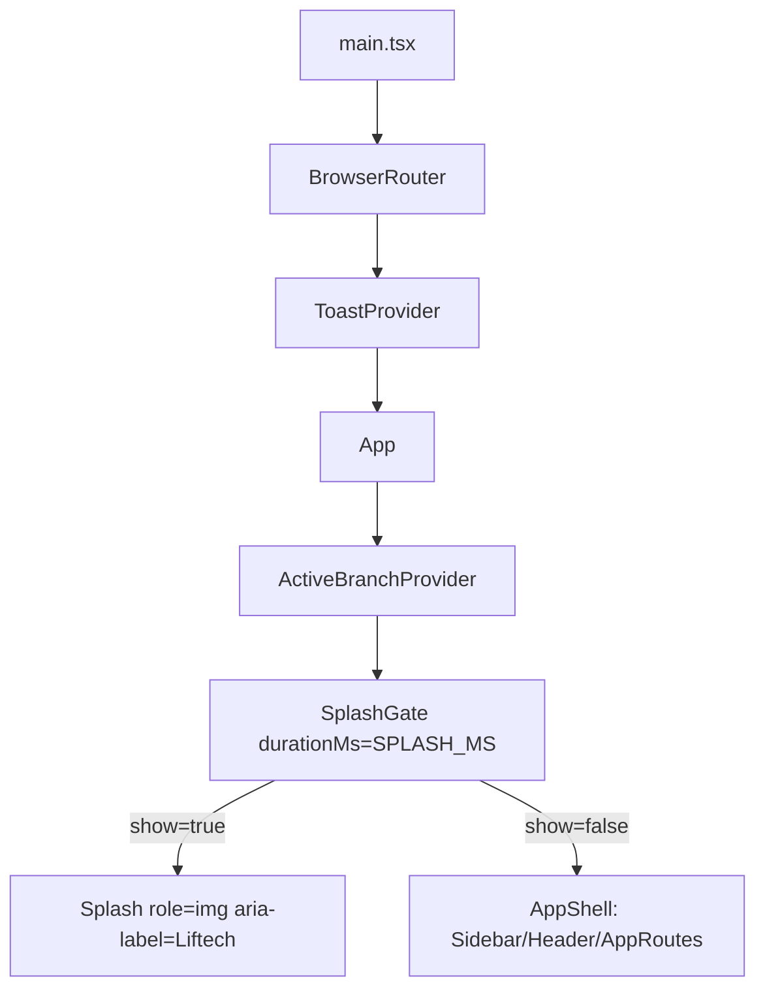

# Splash Design

**Spec**: `.specs/features/figma-splash/spec.md`
**Status**: Draft

---

## Approaches

| # | Abordagem | Prós | Contras |
| - | --------- | ---- | ------- |
| **A (recomendada)** | Um componente `SplashGate` que envolve o `AppShell` em `App.tsx`: decide na montagem se mostra a splash, e com ela visível não renderiza os filhos | 1 componente + 1 CSS Module; nenhuma rota nova; testável isolado com `MemoryRouter` | Precisa de duração 0 em teste para não cobrir os testes do `App` |
| B | Splash estática em `index.html` (HTML/CSS antes do React), removida por script | Aparece antes do JS carregar | Lógica de rota/`sessionStorage`/movimento em JS solto fora do React, difícil de testar; viola o teste de hex nos CSS |
| C | Rota `/splash` com redirecionamento | — | Muda a URL e o histórico; contradiz SPL-01 ("sem alterar a URL") |

Escolha: **A**.

---

## Architecture Overview



`SplashGate` (`Frontend/src/components/common/SplashGate.tsx`):

```tsx
export const SPLASH_MS = import.meta.env.MODE === 'test' ? 0 : 1500
const SEEN_KEY = 'liftech.splashSeen'

function shouldShowSplash(pathname: string, durationMs: number): boolean
// false se durationMs <= 0, rota /funcionario ou /funcionario/*,
// window.matchMedia?.('(prefers-reduced-motion: reduce)').matches, ou sessionStorage[SEEN_KEY] === '1'
// (leitura em try/catch: erro => "não vista")

const SplashGate: React.FC<{ durationMs?: number; children: React.ReactNode }>
// const { pathname } = useLocation()
// const [show, setShow] = useState(() => shouldShowSplash(pathname, durationMs))  // inicializador puro, sem escrita
// useEffect(() => { if (!show) return; try { sessionStorage.setItem(SEEN_KEY, '1') } catch {} ;
//   const t = setTimeout(() => setShow(false), durationMs); return () => clearTimeout(t) }, [show, durationMs])
// return show ? <Splash /> : children
```

- **Decisão só na montagem**: o `useState` com inicializador lê a rota de entrada uma vez; navegar depois não reavalia (edge case "navegação interna").
- **StrictMode**: o inicializador não escreve nada; a escrita da marca fica no efeito e é idempotente. Desmontar/remontar recomeça o timer, o que é correto.
- **Posição**: dentro do `ActiveBranchProvider` e em volta do conteúdo do `AppShell` (o `App` passa a ser `<ActiveBranchProvider><SplashGate durationMs={SPLASH_MS}><AppShell /></SplashGate></ActiveBranchProvider>`). Edita só o export `App` de `App.tsx`; o `figma-modal-alerta` mexe no mesmo arquivo para o provider de alertas e o nível 1 junta os dois.
- **Visual** (`SplashGate.module.css`): `.splash { position: fixed; inset: 0; display: flex; flex-direction: column; align-items: center; justify-content: center; gap: 36px; background: var(--gradient-brand); }`; `.mark { width: 128px; height: auto }`, `.name { width: 192px; height: auto }`; `.mark, .name { filter: brightness(0) invert(1) }`. Sem animação (fora do escopo), então nada a desligar no `prefers-reduced-motion` além do pulo do SPL-03.
- **Token**: `--gradient-brand: linear-gradient(180deg, #41b0ff 20%, #4652ef 100%);` em `index.css`, perto dos tokens de cor. O hero do `AuthLayout` continua com o literal (não é desta feature).

---

## Code Reuse Analysis

| O quê | Onde | Uso |
| ----- | ---- | --- |
| Logo (marca e palavra) | `Frontend/src/assets/logo.svg`, `logo-name.svg` | Importados como em `components/auth/AuthLayout.tsx:5-6` e `components/layout/Sidebar.tsx:19-20` |
| Gradiente da marca | `components/auth/AuthLayout.module.css:111` | Mesmos valores, agora como token em `index.css` |
| Padrão "0 ms em teste" | `hooks/useFirstVisitLoading.ts` (`MOCK_LATENCY_MS`) | `SPLASH_MS` segue o mesmo padrão |
| Detecção de rota do funcionário | `App.tsx` (`isStandaloneRoute`) | Mesma regra `=== '/funcionario' \|\| startsWith('/funcionario/')` |

Nada de `Modal`, `Toast` ou `PageSkeleton`: a splash não é diálogo nem estado de carregamento de página.

---

## Data Models

Nenhum. Estado só no navegador: `sessionStorage['liftech.splashSeen'] = '1'`.

---

## Error Handling

| Situação | Comportamento |
| -------- | ------------- |
| `sessionStorage.getItem` lança | `shouldShowSplash` trata como não vista (SPL-06) |
| `sessionStorage.setItem` lança | Ignorado; a splash segue e some após o tempo (SPL-06) |
| `window.matchMedia` ausente | Optional chaining: sem preferência de movimento reduzido |
| Desmontagem antes do fim | Cleanup do efeito limpa o `setTimeout` |

---

## Testing Strategy

- `Frontend/src/test/components/common/SplashGate.test.tsx` (unit, Testing Library + `vi.useFakeTimers()`): renderiza `<MemoryRouter initialEntries={[path]}><SplashGate durationMs={1500}><p>conteúdo</p></SplashGate></MemoryRouter>`. `beforeEach` limpa o `sessionStorage` (o `setup.ts` só limpa `localStorage`) e remove stubs de `matchMedia`/`sessionStorage` (`vi.unstubAllGlobals()`, `vi.restoreAllMocks()`).
- Um teste por SPL (ver `tasks.md`). Cada um afirma o resultado da spec: presença de `getByRole('img', { name: 'Liftech' })`, ausência do conteúdo, valor no `sessionStorage`.
- `Frontend/src/test/styles/splash.test.ts` (padrão de `test/styles/*.test.ts`, lendo o CSS como texto): `.splash` usa `var(--gradient-brand)` e `position: fixed`; `index.css` declara `--gradient-brand` com `#41b0ff` e `#4652ef`.
- `App.test.tsx` existente segue verde sem alteração, o que prova que `SPLASH_MS` é 0 em teste.
- Visual: no navegador do Orca, 1440 × 900, aba nova em `/login`, comparar com o PNG.
