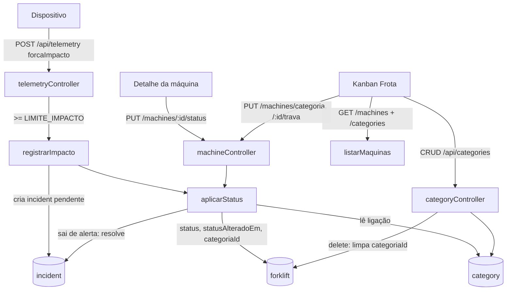

# Categorias da Frota e status da máquina Design

**Spec**: `.specs/features/fleet-categories/spec.md`
**Status**: Approved

---

## Architecture Overview

O status passa a ser um campo gravado na empilhadeira. Toda mudança de status, venha da rota manual ou da leitura de telemetria, passa por uma única função de domínio, `aplicarStatus`, que grava o status, resolve os incidentes quando sai de `alerta` e decide se a máquina muda de categoria (trava desligada + categoria ligada ao novo status). Categorias são uma feature nova (`feature/category`) no molde de `feature/branch`: funções de serviço com o schema direto, escopo por `empresaId`.



### Abordagens consideradas

| Abordagem | Como | Veredito |
| --------- | ---- | -------- |
| **Status gravado + função única de transição** | `forklift.status` gravado; `aplicarStatus` é chamada pela rota manual e pela telemetria | **Escolhida**: a mudança de categoria precisa acontecer no momento da mudança, e um único ponto garante a regra da trava nos dois caminhos |
| Status calculado na leitura | `GET /machines` deriva o status de incidentes e flags | Descartada: não há "momento da mudança" para mover a máquina, e o ajuste manual de status vira um monte de flags |
| Eventos (emitter/fila) | A telemetria emite `impacto`, um listener aplica | Descartada: um único consumidor; indireção sem ganho |

---

## Code Reuse Analysis

### Existing Components to Leverage

| Component | Location | How to Use |
| --------- | -------- | ---------- |
| Feature de filiais | `Backend/src/feature/branch/*` | Molde de CRUD por empresa: `lerId`, `lerNome`, `traduzirErro` (11000 → 409), `exigirEmpresa` |
| Escopo | `Backend/src/core/escopo.ts` | `filtroPorFilial` nas máquinas, `escopo.empresaId` nas categorias, `exigirEmpresa` |
| Corpo seguro | `Backend/src/utils/corpo.ts` | `exigirSemOperadores` nas rotas novas |
| Erros HTTP | `Backend/src/utils/responseHandler.ts` | `ErroHttp`, `responderErro`, `respostaSucesso` |
| Lista de máquinas | `Backend/src/feature/machine/machineService.ts` | Ganha `status`, `categoriaId`, `categoriaTravada`, `alertaEm`; vira também o formatador da resposta das rotas novas |
| Seeds | `Backend/src/scripts/seedEmpresa.ts` (`upsert`), `seedDataset.ts` | Quadro inicial e status do dataset |
| Migração idempotente | `Backend/src/scripts/migrateToBranches.ts` | Molde do `migrate:status` (filtro `campo: null`, contagem no log) |
| Busca com filial ativa | `Frontend/src/pages/VisaoGeralPage.tsx` (efeito com `stale`, `loadState`, `attempt`) | Mesmo padrão na Frota |
| Funções puras do quadro | `Frontend/src/data/fleet.ts` | `moveMachine`, `removeMachine`, `addMachines`, `unassignedMachines`, `categoryNameError`, `isHexColor` seguem; `initialBoard` sai |
| Formulário de categoria | `Frontend/src/components/fleet/CategoryFormModal.tsx` | Ganha modo edição e seleção de status ligados |
| Toast, ConfirmDialog, PageSkeleton | `Frontend/src/components/common/*` | Avisos, exclusão e loading |
| Sessão com escopo | `Frontend/src/services/authService.ts` (`escopo`) | Esconder controles de gerenciar para `escopo: 'filiais'` |

### Integration Points

| System | Integration Method |
| ------ | ------------------ |
| `GET /api/machines` | Formato muda: `status` sai de `dispositivoConectado` e vira campo da máquina, com códigos sem acento |
| `POST /api/telemetry` | Aceita `forcaImpacto`; chama `registrarImpacto` depois de gravar |
| `PUT /api/forklifts/:id` | Passa a recusar os campos de status e categoria |
| MongoDB | Coleção nova `category`; campos novos em `forklift` |

---

## Components

### Status (domínio)

- **Purpose**: Códigos de status e a transição única.
- **Location**: `Backend/src/feature/machine/statusService.ts`
- **Interfaces**:
  - `STATUS = ['disponivel','em_uso','manutencao','alerta','offline'] as const`; `type Status`
  - `ehStatus(valor: unknown): valor is Status`
  - `aplicarStatus(forkliftId: string, novo: Status): Promise<void>` - se `novo` é igual ao atual, não faz nada; senão grava `status` e `statusAlteradoEm`; se o anterior era `alerta`, marca `resolvido` os incidentes pendentes da máquina; se `categoriaTravada` é falso e existe categoria da empresa da filial com `novo` em `statusVinculados`, grava `categoriaId`.
  - `registrarImpacto(dispositivoId: string, forcaImpacto: number, data: Date): Promise<void>` - acha a empilhadeira do dispositivo; sem ela, sai; cria `incident` pendente; chama `aplicarStatus(id, 'alerta')`. Como `alerta` → `alerta` é no-op, um segundo impacto só cria o incidente.
  - `limiteImpacto(): number` - `Number(process.env.LIMITE_IMPACTO)` se finito, senão `5`.
- **Dependencies**: schemas `forklift`, `incident`, `category`, `branch` (empresa da filial).
- **Reuses**: nada novo; schemas diretos como `machineService`.

### Rotas de máquina

- **Purpose**: Trocar status, travar e mover.
- **Location**: `Backend/src/feature/machine/machineController.ts`, `machineRouter.ts`, `machineService.ts`
- **Interfaces**:
  - `PUT /api/machines/categoria` `{ machineIds: string[], categoriaId: string | null }` → 200 `Machine[]`
  - `PUT /api/machines/:id/status` `{ status }` → 200 `Machine`
  - `PUT /api/machines/:id/trava` `{ categoriaTravada: boolean }` → 200 `Machine`
  - `listarMaquinas(escopo, filialId?)` e `obterMaquina(escopo, id)` (novo, reaproveita o mapeamento)
  - `moverParaCategoria(escopo, ids, categoriaId)` - confere todas as ids no escopo (`countDocuments` igual a `ids.length`, senão 404) e a categoria na empresa (senão 404) antes do `updateMany`.
- **Dependencies**: `statusService`, `escopo`.
- **Reuses**: `filtroPorFilial`, `exigirSemOperadores`, `responderErro`.
- **Nota**: `/categoria` é registrada antes de `/:id/...` no router.

### Categorias

- **Purpose**: CRUD das categorias da empresa.
- **Location**: `Backend/src/feature/category/{categoryRouter,categoryController,categoryService}.ts`, `Backend/src/schemas/category.ts`
- **Interfaces**:
  - `GET /api/categories` → `Categoria[]` (qualquer usuário autenticado; filtra por `escopo.empresaId`)
  - `POST /api/categories` `{ nome, cor, statusVinculados? }` → 201
  - `PUT /api/categories/:id` `{ nome?, cor?, statusVinculados? }` → 200
  - `DELETE /api/categories/:id` → 200 `{ _id, message }`
  - `criarQuadroInicial(empresaId): Promise<Map<Status, id>>` - usado pelo seed e pela migração; cria as 4 categorias se a empresa não tem nenhuma.
- **Dependencies**: `escopo`, schemas `category`, `forklift`, `branch`.
- **Reuses**: molde de `branchController`/`branchService`.
- **Regras**: `exigirEmpresa` em POST/PUT/DELETE; nome cortado, 1..40; `cor` regex; `statusVinculados` subconjunto sem repetição de `STATUS`; conflito de status com outra categoria checado por consulta (`{ empresaId, _id: {$ne}, statusVinculados: {$in} }`) → 409; nome duplicado pelo índice único com collation → 409; DELETE faz `Forklift.updateMany({ categoriaId: id }, { $set: { categoriaId: null, categoriaTravada: false } })` e depois apaga.

### Telemetria

- **Purpose**: Aceitar `forcaImpacto` e disparar a regra.
- **Location**: `Backend/src/feature/telemetry/telemetryController.ts`, `telemetryRules.ts`, `schemas/telemetry.ts`
- **Interfaces**: `POST /api/telemetry { dispositivoId, dataDados, forcaImpacto? }`; depois de gravar, `if (forcaImpacto >= limiteImpacto()) await registrarImpacto(...)`.
- **Reuses**: validação `request-check` existente.

### Proteção de `PUT /api/forklifts/:id`

- **Location**: `Backend/src/feature/forklift/forkliftController.ts` (`atualizar`)
- **Interfaces**: lista `CAMPOS_PROTEGIDOS = ['status','statusAlteradoEm','categoriaId','categoriaTravada','sessaoIniciadaEm']`; qualquer um no corpo → 400.

### Migração e seed

- **Location**: `Backend/src/scripts/migrateStatus.ts` (`yarn migrate:status`), `seedData.ts`, `seedDataset.ts`
- **Interfaces**: `migrarStatus()` devolve contagem; mapeia `device.status` antigo nas empilhadeiras com `status: null`, depois `criarQuadroInicial` para cada empresa sem categorias e posiciona as empilhadeiras com `categoriaId: null` cujo status está ligado.
- **Seed**: o dataset troca `status` por códigos; EMP-081/085/089 viram `alerta`; `gerarIncidentes` recebe se a máquina está em alerta (1 pendente + 1 resolvido) ou não (2 resolvidos); `sessaoIniciadaEm` só em `em_uso`.

### Front: tipos e serviços

- **Location**: `Frontend/src/data/machines.ts`, `Frontend/src/services/{machineService,categoryService}.ts`
- **Interfaces**:
  - `type MachineStatus = 'disponivel' | 'em_uso' | 'manutencao' | 'alerta' | 'offline'`; `Machine` ganha `status`, `categoriaId: string | null`, `categoriaTravada: boolean`, `alertaEm?: string | null`; `dispositivoConectado` perde `status`.
  - `machineService.mover(ids, categoriaId)`, `.alterarStatus(id, status)`, `.travar(id, valor)`
  - `categoryService.listar()`, `.criar(dados)`, `.atualizar(id, dados)`, `.remover(id)`
  - Mocks (`MACHINES`, área do funcionário) migram para o novo formato.

### Front: status compartilhado

- **Purpose**: Uma fonte de rótulo e cor do status, no lugar dos 4 mapas copiados.
- **Location**: `Frontend/src/components/machines/StatusBadge.tsx` (+ `.module.css`)
- **Interfaces**: `<StatusBadge status />` (rótulo `machines.status.<codigo>`), `STATUS_TONE: Record<MachineStatus, string>` para o cabeçalho do `FleetCard`.
- **Reuses**: classes de cor existentes em `MachineCard.module.css`.
- **Usado por**: `MachineCard`, `MachineDetailModal`, `FleetCard`, `MachineListCard`, filtro da Visão Geral.

### Front: Frota

- **Location**: `Frontend/src/pages/FrotaPage.tsx`, `components/fleet/{FleetCard,FleetRow,CategoryFormModal}.tsx`, `data/fleet.ts`
- **Interfaces**:
  - Estado: `categorias: Categoria[]`, `maquinas: Machine[]`; as linhas vêm de `categorias.map(c => maquinas.filter(m => m.categoriaId === c._id))`.
  - Ações otimistas: `aplicarOtimista(mudanca, chamada)` guarda o estado anterior, aplica, chama a API e restaura + `toast` de erro em falha.
  - `FleetCard`: destaque por `machine.status` (não por `kind`), selo `StatusBadge`, botão de cadeado (trava).
  - `FleetRow`: editar/excluir só com `podeGerenciar`; ícone pela `chave`.
  - `CategoryFormModal`: modo criar/editar, checkboxes dos 5 status com o status já ligado a outra categoria desabilitado.
- **Reuses**: funções puras de `data/fleet.ts` passam a operar sobre `machineIds` derivados.

### Front: detalhe da máquina

- **Location**: `Frontend/src/components/machines/MachineDetailModal.tsx`
- **Interfaces**: novas props opcionais `onChangeStatus?(status)` e `onToggleLock?(valor)`; com elas, mostra um `select` de status e o botão de trava. Visão Geral e Frota passam as duas.

---

## Data Models

### category (novo)

```typescript
interface Category {
  _id: ObjectId
  empresaId: ObjectId        // ref company, required, index
  nome: string               // trim, required, maxlength 40
  cor: string                // ^#[0-9a-fA-F]{6}$
  chave: 'acidentes' | 'ativas' | 'manutencao' | 'disponiveis' | null
  statusVinculados: Status[] // default []
}
// índice único { empresaId: 1, nome: 1 } com collation { locale: 'pt', strength: 2 }
```

### forklift (campos novos)

```typescript
interface ForkliftNovos {
  status: Status | null          // null = dado antigo, lido como 'disponivel'
  statusAlteradoEm: Date | null
  categoriaId: ObjectId | null   // ref category, index
  categoriaTravada: boolean      // default false
}
```

### telemetry (campo novo)

```typescript
interface TelemetryNovos { forcaImpacto?: number }
```

### Resposta `Machine` da API

```typescript
interface Machine {
  id: string; identificacao: string; nome: string; setor: string; filialId: string
  status: Status
  categoriaId: string | null
  categoriaTravada: boolean
  alertaEm: string | null        // só preenchido com status 'alerta'
  dispositivoConectado: { enderecoMac: string }
  operadorConectado?: { nome: string }
  tempoSessaoMinutos: number
}
```

**Relationships**: `category.empresaId` → company; `forklift.categoriaId` → category (mesma empresa da filial da empilhadeira); `incident.empilhadeiraId` → forklift.

---

## Error Handling Strategy

| Error Scenario | Handling | User Impact |
| -------------- | -------- | ----------- |
| Corpo inválido (status, cor, nome, ids) | 400 `ErroHttp` antes de qualquer escrita | Aviso de erro; tela volta ao estado anterior |
| Máquina ou categoria fora do escopo | 404 | Idem |
| Escopo filiais gerenciando categoria | 403 | Controles nem aparecem; 403 só por chamada direta |
| Nome ou status ligado em conflito | 409 | Formulário mostra o erro e mantém os dados |
| Falha ao resolver incidentes depois de gravar o status | Erro 500; status já gravado | Raro; `ponytail:` sem transação, documentado |
| Falha na regra de impacto | Telemetria já gravada; resposta 500 | O dispositivo reenvia; o incidente pode ficar sem o status (log) |
| Rede no front | Rollback + toast de erro | Quadro volta ao que era |

---

## Risks & Concerns

| Concern | Location (file:line) | Impact | Mitigation |
| ------- | -------------------- | ------ | ---------- |
| `PUT /forklifts/:id` aceita qualquer campo | `Backend/src/feature/forklift/forkliftController.ts:113-127` | Contornaria status, trava e categoria | Lista de campos protegidos (STS-09) |
| Seed cria incidente pendente em toda máquina | `Backend/src/scripts/seedDataset.ts:118` | Tudo viraria `alerta` no migrate | Seed ajustado (MIG-07) |
| `POST /telemetry` exige token de usuário | `Backend/src/app.ts` (`autenticar`) | Dispositivo real ainda não consegue enviar | Fora de escopo, registrado no STATE (pendência do AD-010) |
| Sem transação no Mongo | `statusService.aplicarStatus`, `categoryService.excluir` | Escrita parcial em falha no meio | Ordem segura (grava status antes de mover; limpa máquinas antes de apagar a categoria) + comentário `ponytail:` |
| 4 mapas de status duplicados no front | `MachineCard.tsx:12`, `MachineDetailModal.tsx:26`, `FleetCard.tsx:40`, `MachineListCard.tsx:15` | Novo status esquecido em um deles | `StatusBadge` único |
| "Offline" sem tradução hoje | `MachineCard.tsx:27-31` | Rótulo cru | Chaves `machines.status.*` nos 7 idiomas |
| Lista de máquinas sem índice em `categoriaId` | `schemas/forklift.ts` | `updateMany` do delete varre a coleção | `index: true` no campo |
| Testes do front usam `dispositivoConectado.status` com acento | `Frontend/src/test/**` | Muitos testes quebram com o novo tipo | Task dedicada para migrar mocks e testes antes das telas |

---

## Tech Decisions

| Decision | Choice | Rationale |
| -------- | ------ | --------- |
| Onde fica o status | `forklift.status`, não `device.status` | O status é da máquina; o device só informa leituras |
| Formato do status | Códigos sem acento | Comparação estável; tradução no front |
| Uma rota de mover | `PUT /machines/categoria` com lista | Cobre arrastar, "Mover para", remover e adicionar em lote |
| Transição única | `aplicarStatus` | A regra da trava vale igual para leitura e ajuste manual |
| Limite de impacto | `LIMITE_IMPACTO` no `.env`, padrão 5 | Precisa de calibração em campo |
| Nome único sem caixa | Índice único com collation `strength: 2` | O banco garante, sem corrida |
