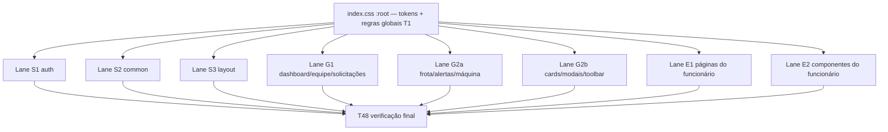

# Frontend Harmonia Design

**Spec**: `.specs/features/frontend-harmonia/spec.md`
**Status**: Draft

Princípio (ponytail): reusar a escala `--fs-*`, os 3 níveis de texto e os tokens `--card-*`. Tokens novos só quando um papel não tem como existir sem eles (3 cores de texto acessíveis, 1 tracking, 4 de motion). Nenhuma mudança de estrutura, posição, grid ou componente.

---

## 1. Arquitetura



- **Fase 1 (T1)** muda só `Frontend/src/index.css`. Tudo depois depende dos tokens dela.
- **Fase 2**: 8 lanes paralelas, uma por worker. Cada lane tem arquivos **disjuntos** (CSS/TSX + os testes que ela possui). Dentro da lane, as tarefas são sequenciais (1 commit cada).
- **Fase 3 (T48)**: gates completos, detector, greps de aceitação, sem editar código.

---

## 2. Sistema de papéis tipográficos (autoridade)

Fonte única Host Grotesk; pesos **400 / 500 / 600**; 700 só em data-display. Tracking do corpo continua `0.18px` (`:root`).

| Papel | font-size | weight | line-height | tracking | cor | Seletores de referência |
|---|---|---|---|---|---|---|
| display | `--fs-3xl` 32 | 500 (600 sobre gradiente) | 1.2 | `var(--tracking-display)` | `--blue` (título auth, decisão de marca) / `--white` | `AuthLayout .title`, `.heroTitle` |
| data-display | 48px timer · 64px 404 · `--fs-2xl` KPI (exceções documentadas) | 700 (404: 600) | 1–1.1 | herda / 404 `-1.68px` | `--text-h` | `EmployeeSessionPage .timer`, `NotFoundPage .code`, `DashboardPage .cardNumber`, `InfoField .highlight .label` — sempre `tabular-nums` |
| page-title (h1) | `--fs-2xl` (mobile `--fs-xl`) | 500 | 1.25 | 0 | `--text-h` | `Header .title`, h1 de Dashboard/Solicitações/telas do funcionário |
| modal-title (h2) | `--fs-xl` | 500 | 1.25 | 0 | `--text-h` | `Modal .title`, `NewMachinePanel .title`, `NotFoundPage .title` |
| sheet-title (mobile) | `--fs-lg` | 500 | 1.25 | 0 | `--text-h` | `BottomSheet .title` |
| panel-title | `--fs-lg` | 600 | 1.25 | 0 | `--text-h` | títulos de painel do Dashboard, `MachineTable`, `UsageHeatmap`, `EquipePage .sectionTitle` |
| section-title / popover-title | `--fs-base` | 600 | 1.3 | herda | `--text-h` | `Header .popoverTitle`, `AlertsDropdown .titleButton` (cor `--blue-text`), `.sectionTitle`/`.filtersTitle` do funcionário, `AuthForm .successTitle` |
| card-title | `--fs-md` | 600 | 1.3 | herda | `--text-h` | `MachineCard .nome`, `EmployeeCard .name`, `SectorCard .name`, `MachineListCard .nome`, `EmployeeHomePage .lastName` |
| body | `--fs-base` | 400 | 1.45 | herda | `--text` | `ConfirmDialog .message`, subtítulos, parágrafos |
| control | `--fs-md` (gestor) · `--fs-base` (funcionário, Q5) | 400 (nav/trigger 500) | herda | herda | valor `--text-h` | inputs, selects, opções de lista, `Sidebar .navLink` |
| key-value | `--fs-md` | rótulo 600 / valor 400 | 1.3 | herda | rótulo `--text-h`, valor `--text` | `InfoField`, `ProfileModal .label/.value` |
| field-label | `--fs-sm` | 600 | 1.3 | herda | `--text-h` | `TeamForm .label`, `NewMachinePanel .label`, `IncidentSheet .label`, `EmployeeSettingsPage .label`, `AuthForm .sectionTitle` |
| group-label | `--fs-sm` | 500 | 1.3 | herda | `--text-label` | `Sidebar .sectionLabel`, `BranchSelector .label` |
| button | `--fs-sm` | 600 | herda | herda | `--white` (fill) / `--blue-text` (ghost) | `DialogButtons`, `.logoutButton`, `.feedbackButton`, ações inline, retry |
| button-lg | `--fs-md` | 600 | herda | herda | `--white` | toolbar "Cadastrar", `AuthForm .submitButton`, `NotFoundPage .cta`, `MachineTable .createButton` |
| button-touch | `--fs-base` | 600 | herda | herda | `--white` | botões primários/secundários de 40–44px do funcionário |
| link | herda | 500 | herda | herda | `--blue-text` | `AuthForm .forgotLink`, links de tabela |
| tab | `--fs-sm` (Solicitações `--fs-md`) | 600 | herda | herda | `--blue-text` / ativa `--white` | `AuthLayout .tab`, `MachineDetailModal .tab` |
| meta / caption | `--fs-xs` | 400 | 1.35 | herda | `--text-label` | códigos, filial, hora, `AuthLayout .infoCardDesc` |
| badge / count | `--fs-xs` | 500 | 1 (pill de altura fixa) | herda | contextual | `StatusBadge`, chips, `.moreButton`, contadores — sempre `tabular-nums` |
| status-text | herda do badge | 500 | — | — | `--yellow-text` (manutenção), `--danger-text`, `--green` | `StatusBadge .manutencao`, `FleetRow .manutencao` |
| error | `--fs-sm` | 500 | 1.35 | herda | `--danger-text` | `TeamForm .error`, `BranchSelector .alert`, `AlertsDropdown .errorText`, erros de sheet/modal |
| empty | página `--fs-base` · contêiner `--fs-sm` | 400 | herda | herda | `--text` | `.empty`, `.emptyState`, `.noResults` |
| data / number | do papel | do papel | do papel | do papel | do papel | **+ `font-variant-numeric: tabular-nums`** (KPI, timer, hora, data, paginação, contagem, hex) |

Exceções (não mexer): `NotFoundPage .code` 64px; `EmployeeSessionPage .timer` 48px; textos em `--px` de Frota/Alertas (Q4); espaçamentos da auth (AD-007).

---

## 3. Tokens e regras globais (T1, `Frontend/src/index.css`)

Adicionar em `:root` (depois de `--text-label`), e trocar a definição de `--text-muted`:

```css
  --text-muted: var(--text-label);       /* era #a0aec0 (2,26:1); 10 usos de texto */
  --blue-text: #1f78d1;                  /* texto azul 4,5:1; --blue fica para fundo/ícone */
  --danger-text: var(--urgency-critical);/* #c84646, 4,75:1 */
  --yellow-text: #726800;                /* status manutenção, 5,49:1 sobre --yellow-bg */
  --tracking-display: -0.01em;

  --ease-out: cubic-bezier(0.23, 1, 0.32, 1);
  --dur-fast: 120ms;   /* hover, press, cor, chevron */
  --dur-base: 180ms;   /* entrada de popover, dialog, toast, backdrop */
  --dur-slow: 220ms;   /* gaveta / sidebar */
```

Substituir o bloco `/* Rever ... */ * { font-family: var(--sans); }` por:

```css
button,
input,
select,
textarea {
  font-family: inherit;
  letter-spacing: inherit;
}

::placeholder {
  color: var(--text-label);
  opacity: 1;
}
```

Trocar as regras de título e parágrafo por:

```css
h1,
h2,
h3 {
  letter-spacing: 0;
  line-height: 1.25;
  text-wrap: balance;
}

h1,
h2 {
  font-family: var(--heading);
  font-weight: 500;
  color: var(--text-h);
}
/* h1 (font-size + margin + media) fica igual; h2 perde o `line-height: 118%` */

p {
  margin: 0;
  text-wrap: pretty;
}
```

Não usar `font: inherit`/`line-height: inherit` nos controles (muda altura de botão, Q16). `index.html` continua carregando `wght@400;500;600;700` (700 segue em data-display, Q10).

---

## 4. Ritmo de espaçamento

- Série válida: 2, 4, 8, 12, 16, 20, 24, 32, 48 (e a mesma série em `calc(N * var(--px, 1px))` dentro de Frota/Alertas).
- Mesmo papel, mesmo espaço interno: opção de lista `8px 10px`; botão compacto `8px 16px`; casca de painel `24px` + `1px solid var(--line)` + `var(--radius-lg)`; rodapé de modal `16px 30px`; vazio de página `48px 0`.
- Valores ímpares que **ficam**: `Modal .body 28px 30px` (Q3), espaços da auth (AD-007), `Toast` `14px` à esquerda (compensa a borda de 3px).
- Padding de página e gap entre seções de página **não** mudam (Q6).

---

## 5. Movimento

| Uso | Valor |
|---|---|
| hover, press, troca de cor, chevron, opacity de botão | `var(--dur-fast) var(--ease-out)` |
| entrada de popover, dialog, toast, backdrop, sheet do gestor | `var(--dur-base) var(--ease-out)` |
| sidebar (desktop `width` e mobile `transform`) | `var(--dur-slow) var(--ease-out)` |
| press de botão | `:active { transform: scale(0.97) }` (botões que já usam `0.98` mantêm) |
| loops | `spin 1s linear`, `shimmer 1.2s ease-in-out` (skeleton do sheet passa de 1.5s para 1.2s) |
| fora do escopo | durações do shell do funcionário (TabBar, EmployeeLayout, BottomSheet) — testes fixam |

Nenhuma animação nova de `width/height/top`. A regra global de reduced-motion (`index.css`) cobre CSS; o loop JS do vídeo da sessão passa a checar `matchMedia('(prefers-reduced-motion: reduce)')`.

---

## 6. Mapa arquivo → lane → tarefa (posse disjunta)

Caminhos relativos a `Frontend/src/`. "Testes possuídos" = só esta lane pode editar. Testes **somente leitura** para todas as lanes: `test/styles/pageSkeleton.test.ts`, `test/styles/employeeSkeleton.test.ts`, `test/styles/polishControls.test.ts`, `test/styles/polishCards.test.ts`, `test/styles/no-hardcoded-colors.test.ts`, `test/styles/employeeSessionBar.test.ts`, `test/styles/employeeMotion.test.ts`, `test/styles/employeeShell.test.ts`, `test/styles/tokens.test.ts`, `test/styles/font.test.ts`, `test/styles/surfaces.test.ts`, `test/styles/splash.test.ts`, `test/styles/team.test.ts`, `test/styles/cards/SectorCard.test.ts`.

| Lane | Tarefas | Arquivos | Testes possuídos | Achados |
|---|---|---|---|---|
| F | T1 | `index.css` | `test/styles/harmony/foundation.test.ts` (novo) | H01 H02 H03 H05 H06 H07 H09 H16 H51 H52 |
| S1 auth | T2–T5 | `components/auth/AuthLayout.module.css`, `components/auth/AuthLayout.tsx`, `components/auth/AuthForm.module.css`, `pages/NotFoundPage.module.css` | `test/styles/authMobile.test.ts`, `test/components/auth/AuthLayout.test.tsx`, `test/styles/harmony/auth.test.ts` (novo) | H02 H03 H09 H10 H11 H12 H13 H14 H22 H23 H25 H51 H52 |
| S2 common | T6–T10 | `components/common/Modal.module.css`, `DialogButtons.module.css`, `Toast.module.css`, `Select.module.css`, `Card.module.css` | `test/styles/common.test.ts`, `test/styles/cards/Card.test.ts`, `test/styles/harmony/common.test.ts` (novo) | H09 H25 H38 H39 H40 H52 H54 |
| S3 layout | T11–T17 | `components/layout/Header.module.css`, `Sidebar.module.css`, `Sidebar.tsx`, `AlertsDropdown.module.css`, `BranchSelector.module.css`, `ProfileModal.module.css`, `AccountActionModal.tsx` | `test/styles/layout.test.ts`, `test/styles/harmony/layout.test.ts` (novo) | H03 H06 H20 H21 H22 H25 H26 H31 H32 H35 H39 H51 H52 H53 |
| G1 | T18–T25 | `pages/DashboardPage.module.css`, `components/dashboard/MachineTable.module.css`, `components/dashboard/UsageHeatmap.module.css`, `pages/SolicitacoesPage.module.css`, `pages/EquipePage.module.css`, `components/team/EmployeeCard.module.css`, `components/team/TeamForm.module.css`, `components/accessRequests/AccessRequestCard.module.css` | `test/styles/cards/DashboardKpi.test.ts`, `cards/DashboardHeights.test.ts`, `cards/grids.test.ts`, `cards/EmployeeCard.test.ts`, `cards/AccessRequestCard.test.ts`, `test/styles/harmony/gestor.test.ts` (novo) | H02 H06 H15 H18 H22 H26 H30 H33 H43 H48 H51 H52 H57 H58 H59 H60 |
| G2a | T26–T32 | `components/fleet/FleetCard.module.css`, `FleetRow.module.css`, `CategoryFormModal.module.css`, `MachinePickerModal.module.css`, `components/machines/StatusBadge.module.css`, `components/machines/MachineDetailModal.module.css`, `pages/AlertasPage.module.css` | `test/styles/cards/FleetCard.test.ts`, `test/styles/fleet.test.ts`, `test/styles/machines.test.ts`, `test/styles/polishFleet.test.ts`, `test/styles/harmony/fleet.test.ts` (novo) | H02 H06 H07 H08 H09 H22 H24 H25 H26 H30 H33 H36 H43 H52 H56 |
| G2b | T33–T39 | `components/machines/NewMachinePanel.module.css`, `components/machines/MachineCard.module.css`, `components/alerts/LevelInfoModal.module.css`, `components/feedback/FeedbackModal.module.css`, `pages/VisaoGeralPage.module.css`, `pages/FrotaPage.module.css`, `components/accessRequests/InitialPasswordModal.tsx` | `test/styles/cards/MachineCard.test.ts`, `test/components/accessRequests/InitialPasswordModal.test.tsx`, `test/styles/harmony/machines.test.ts` (novo) | H02 H06 H17 H19 H23 H24 H27 H30 H34 H51 H57 H61 |
| E1 | T40–T44 | `pages/employee/EmployeeSettingsPage.module.css`, `EmployeeSessionPage.module.css`, `EmployeeSessionPage.tsx`, `EmployeeHomePage.module.css`, `EmployeeHistoryPage.module.css` | `test/styles/cards/EmployeeSettings.test.ts`, `test/styles/employeeSession.test.ts`, `test/styles/employeeHome.test.ts`, `test/styles/employeeHistory.test.ts`, `test/pages/employee/EmployeeSessionPage.test.tsx`, `test/styles/harmony/employeePages.test.ts` (novo) | H02 H15 H17 H18 H22 H24 H26 H27 H30 H33 H37 H63 H64 |
| E2 | T45–T47 | `components/employee/IncidentSheet.module.css`, `MachineDetailSheet.module.css`, `MachineListCard.module.css` (BottomSheet e EmployeeMachinesPage já estão no papel: sem mudança) | `test/styles/employeeIncident.test.ts`, `test/styles/employeeSheet.test.ts`, `test/styles/employeeMachines.test.ts`, `test/styles/cards/MachineListCard.test.ts`, `test/styles/harmony/employeeComponents.test.ts` (novo) | H02 H06 H22 H23 H24 H26 H30 H33 H50 H62 |
| V | T48 | nenhum (só leitura) | — | todos |

Verificado: nenhum arquivo aparece em duas lanes; todo teste que lê arquivos de duas lanes está na lista somente-leitura (`pageSkeleton`, `employeeSkeleton`, `polishControls`, `employeeSheet` lê `StatusBadge` mas pertence a E2 e G2a não muda o que ele afirma).

---

## Code Reuse Analysis

| Existente | Local | Uso |
|---|---|---|
| Escala `--fs-*`, `--text*`, `--card-*`, `--radius-*` | `index.css` | todos os papéis usam estes tokens |
| `--urgency-critical` (#c84646) | `index.css` | vira `--danger-text` (alias) |
| `--text-label` (#707070) | `index.css` | placeholder e alias de `--text-muted` |
| `@keyframes fade-in` | `components/common/Modal.module.css` | copiar para o backdrop de `NewMachinePanel` (CSS Modules não compartilha keyframes) |
| `shimmer 1.2s` | `components/common/PageSkeleton.module.css:152` | duração de referência para o `pulse` do sheet |
| Helpers `read`/`block` dos testes de estilo | `test/styles/*.test.ts`, `test/styles/cards/shell.ts` | padrão dos testes novos em `test/styles/harmony/` |

## Integration Points

| Sistema | Integração |
|---|---|
| Testes de estilo (vitest, regex sobre CSS) | cada lane atualiza só os testes que possui; testes somente-leitura devem continuar verdes |
| i18n | só `AuthLayout.tsx` lê `t()` para o `title` das abas; nenhuma chave nova |

---

## Error Handling Strategy

| Cenário | Tratamento | Impacto |
|---|---|---|
| Seletor/valor descrito na tarefa não existe no arquivo | Worker para e reporta ao orquestrador (escalation) | nenhuma edição às cegas |
| Mudança quebra teste somente-leitura | Reverter a mudança daquele seletor e reportar | layout preservado |
| Gate com Node < 20.19 | Rodar com `$HOME/.nvm/versions/node/v22.22.2/bin` no PATH | evita falso vermelho |

---

## Risks & Concerns

| Concern | Location (file:line) | Impact | Mitigation |
|---|---|---|---|
| Skeletons espelham alturas de texto | `test/styles/pageSkeleton.test.ts:46-50`, `test/styles/employeeSkeleton.test.ts:63` | mudar font-size/lh de card desloca o conteúdo no carregamento | testes somente-leitura; Q4 e Q7 mantêm InfoField e `--px`; mudanças de 1px em card-title (E1 `.lastName` 12→13) devem rodar `employeeSkeleton.test.ts` |
| Suíte falha com o Node do PATH | `Frontend/package.json` engines `>=20.19`; máquina 20.18.1 | 129 arquivos vermelhos antes de qualquer mudança | gates com Node 22.22.2 |
| `--blue-text` muda o tom de 30 usos de texto azul | `grep "color: var(--blue)"` (30) | azul fica mais escuro em links e abas | trocar só onde o papel é texto ≤ 14px; ícones e fundos seguem `--blue` |
| Alias de `--text-muted` escurece ícones decorativos | `MachineTable .searchIcon`, `UsageHeatmap` | ícone um pouco mais escuro | aceito (Q12) |
| Divisor do TeamForm acoplado ao padding do Modal | `components/team/TeamForm.module.css:91` | quebraria se o body mudasse | Q3 mantém 30px |
| Bloco DEV temporário na Sidebar | `components/layout/Sidebar.tsx:196-225` | código `// TEMP` (AD-007) | só troca `fontSize: 12` por token; remoção é outra decisão |

---

## Tech Decisions

| Decisão | Escolha | Motivo |
|---|---|---|
| Alias em vez de trocar 10 usos de `--text-muted` | `--text-muted: var(--text-label)` | 1 linha, mesmo resultado |
| Sem tokens `--fs-display/--fs-hero` | exceções documentadas | 1 uso cada; teste fixa 48px |
| Teste por lane em `test/styles/harmony/<lane>.test.ts` | arquivo novo por lane | posse disjunta; cada tarefa acrescenta um `describe` |
| Durações do shell mobile fora | não tocar TabBar/EmployeeLayout/BottomSheet motion | testes fixam; família de gestos própria |
