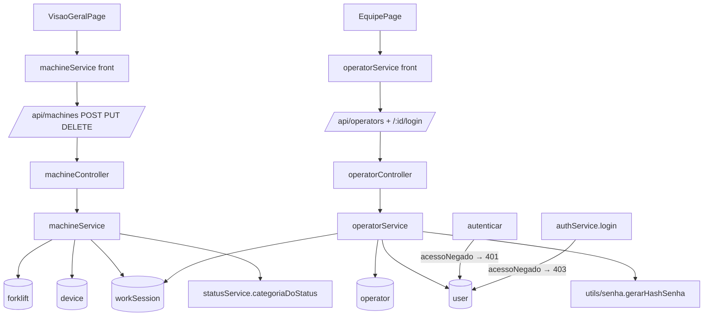

# machines-team-crud Design

**Spec**: `.specs/features/machines-team-crud/spec.md`
**Status**: Approved

---

## Architecture Overview

Segue AD-002/AD-011 no formato funcional da `category` (router → controller → service, sem repository) e o escopo de AD-008/AD-010. Conforma com todos os ADs; nenhum é substituído.



Abordagem única: as rotas novas vivem nas features que já existem (`machine`) ou numa feature nova no mesmo molde (`operator`). Alternativas descartadas: estender `/api/forklifts` (devolve outro formato, não cria device) e `/api/users` (escopo por empresa, não por filial do operador; não sabe de `operadorId` nem de senha).

---

## Code Reuse Analysis

| Componente | Local | Uso |
| ---------- | ----- | --- |
| `lerId`, `exigirSemOperadores`, `responderErro` | `machineController.ts`, `utils/corpo.ts`, `utils/responseHandler.ts` | Mesma leitura de id e corpo |
| `filtroPorFilial`, `resolverFilial` | `core/escopo.ts` | Escopo de leitura e filial do recurso novo |
| `consultar` / `obterMaquina` | `machine/machineService.ts` | Resposta no formato `Machine` e 404 de escopo |
| Busca da categoria por status | `machine/statusService.ts` (`aplicarStatus`) | Extraída para `categoriaDoStatus(empresaId, status)`; `aplicarStatus` passa a usá-la |
| `CAMPOS_PROTEGIDOS` | `forklift/forkliftController.ts` | Mesma lista + `operadorConectadoId`, `dispositivoConectadoId`, `filialId` |
| `traduzirErro` (11000 → 409) | `category/categoryService.ts` | Mesmo padrão no MAC e no usuário |
| `gerarHashSenha` | `utils/senha.ts` | Hash da senha do login |
| `updateMachine` otimista | `VisaoGeralPage.tsx` | Generalizado para criar, editar e excluir |
| `PageSkeleton` + erro com retry | `VisaoGeralPage.tsx` | Mesmo carregamento na Equipe |
| `isUsernameTaken`, `filterEmployees` | `data/team.ts` | Continuam no front sobre a lista da API |

Código morto removido: `feature/operator/operatorRepository.ts` e `models/operatorModel.ts` (só se referenciam entre si).

---

## Components

### Schemas
- `operator`: + `matricula`, `telefone`, `cargo`, `horarioEntrada`, `horarioSaida` (String, `trim`).
- `user`: + `acessoNegado: { type: Boolean, default: false }`.
- `device`: + `nome: String`; `enderecoMac` com `unique: true`.

### `core/autenticar.ts`
- `autenticar`: `usuario.acessoNegado === true` → 401 "Não autenticado.".
- `exigirAdmin(usuario: UsuarioRequisicao, mensagem: string): void` → 403 se `role !== 'admin'`.

### `auth/authService.ts` + `authController.ts`
- `login`: senha certa + `acessoNegado` → `throw new ErroHttp(403, "Acesso negado.")`; controller passa a usar `responderErro` depois do caso de credenciais.

### `machine/statusService.ts`
- `categoriaDoStatus(filialId, status): Promise<ObjectId | null>` (filial → empresa → categoria com o status).

### `machine/machineService.ts`
- `consultar`: + `dispositivoConectado.nomeDispositivo` (de `device.nome`).
- `criarMaquina(escopo, dados: DadosMaquina & { filialId })` → Machine.
- `atualizarMaquina(escopo, id, dados: DadosMaquina)` → Machine.
- `excluirMaquina(escopo, id)` → `{ _id, message }`.
- `DadosMaquina = { nome?, identificacao?, setor?, nomeDispositivo?, enderecoMac? }`; MAC normalizado `trim().toUpperCase()`.
- Criar: checa identificação (`Forklift.exists`) e MAC (`Device.exists`) → 409; cria device; cria forklift com `status: 'disponivel'`, `statusAlteradoEm: now`, `categoriaId: categoriaDoStatus(...)`; se o forklift falhar, apaga o device. 11000 → 409 MAC.
- Atualizar: `obterMaquina` (404); identificação nova checada contra outras; MAC novo checado contra outros devices; grava forklift e device.
- Excluir: `obterMaquina`; `WorkSession.exists({ empilhadeiraId, fim: null })` → 409; apaga forklift e device.

### `machine/machineController.ts` + router
- `criar`, `atualizar`, `deletar`: `lerCorpo`, validação (obrigatórios no POST, lista fechada no PUT), `resolverFilial` no POST. Rotas `POST /`, `PUT /:id`, `DELETE /:id` (depois de `/categoria`, `/:id/status`, `/:id/trava`).
- Sem `exigirAdmin` (as rotas de máquina seguem AD-011: qualquer usuário do escopo).

### `operator/operatorService.ts`
- `listar(escopo, filialId?)`, `criar(escopo, dados & { filialId })`, `atualizar(escopo, id, dados)`, `excluir(escopo, id)`.
- `criarLogin(escopo, id, { usuario, senha })`, `atualizarLogin(escopo, id, { senha?, acessoNegado? })`, `removerLogin(escopo, id)`.
- `formatar(operadores)`: uma consulta `User.find({ operadorId: { $in } })` para `usuario` e `acesso`.
- Matrícula: filiais da empresa (`Branch.find({ empresaId })`) → maior `EMP-NNN` entre os operadores delas + 1, com 3 dígitos.

### `operator/operatorController.ts` + `operatorRouter.ts`; `app.ts` monta `/api/operators`
- Toda rota chama `exigirAdmin(req.usuario, "Apenas administradores podem gerenciar a equipe.")`.
- Validação: `nome` 1–80; `telefone`, `cargo` texto até 40; horários `/^([01]\d|2[0-3]):[0-5]\d$/` ou vazio; `usuario` `/^\S{3,40}$/`; `senha` 8–72; `acessoNegado` boolean.

### Front
- `services/machineService.ts`: `criar(values, filialId?)`, `atualizar(id, values)`, `remover(id)`.
- `services/operatorService.ts`: `listar(filialId?)`, `criar`, `atualizar`, `remover`, `criarLogin`, `atualizarLogin`.
- `NewMachinePanel`: MAC obrigatório; prop `branches?: Filial[]` mostra o select Filial (só no cadastro).
- `VisaoGeralPage`: criar/editar/excluir otimistas; `409` na exclusão → `machines.deleteInSession`; outro erro → `machines.saveError`.
- `data/team.ts`: `Employee` = resposta da API (`usuario: string | null`, `filialId`, sem `senha`); saem `EMPLOYEES` e `nextEmployeeCode`.
- `EmployeeFormModal`: senha opcional na edição de quem tem login; usuário só leitura quando já tem login; senha ≥ 8; select Filial no cadastro.
- `EmployeeInfoModal`: sem a linha de senha. `EmployeeCard`: interruptor desabilitado sem login.
- `EquipePage`: carga da filial ativa com skeleton/erro; editar/excluir/acesso otimistas; criar espera a API.

---

## Data Models

```typescript
// Resposta de /api/operators
interface Employee {
  id: string
  matricula: string
  nome: string
  telefone: string
  cargo: string
  horarioEntrada: string
  horarioSaida: string
  filialId: string
  usuario: string | null
  acesso: 'Permitido' | 'Negado'
}
```

`Machine` ganha `dispositivoConectado.nomeDispositivo` vindo da API (o tipo do front já tem o campo opcional).

---

## Error Handling Strategy

| Cenário | Backend | Usuário vê |
| ------- | ------- | ---------- |
| Identificação/MAC/usuário repetido | 409 (checagem e 11000) | Toast de erro; criação de máquina desfeita; usuário volta ao formulário com erro |
| Excluir com sessão aberta | 409 | Toast "com sessão aberta" e item volta à lista |
| Fora do escopo | 404 | Toast de erro genérico e rollback |
| Login falha depois do operador criado | 4xx no segundo POST | Funcionário aparece sem login + toast `team.loginError` |
| Colaborador chama `/api/operators` | 403 | (não há tela de equipe para colaborador) |

---

## Risks & Concerns

| Concern | Location | Impact | Mitigation |
| ------- | -------- | ------ | ---------- |
| Rotas antigas sem checagem de role | `app.ts:57` | Colaborador com token chama rotas de admin | Fora do escopo (spec); só as rotas novas ganham `exigirAdmin` |
| Índice único em `device.enderecoMac` | `schemas/device.ts` | O Mongo não cria o índice se já houver MAC repetido | Avisar o dono no Handoff para conferir duplicados; a checagem no service vale mesmo sem índice |
| Criação sem transação (device + forklift; operador + login) | `machineService`, front da Equipe | Falha no meio deixa device órfão ou operador sem login | Compensação (apaga o device) e `ponytail:`; no front o operador sem login é estado válido |
| Matrícula sem índice | `operatorService` | Dois cadastros simultâneos geram a mesma matrícula | `ponytail:` com o caminho (índice quando o operador tiver `empresaId`) |
| `PUT /api/users/:id` não protege `acessoNegado`/`operadorId` | `userController.ts:130` | — | Já recusa campos fora de `CAMPOS_LIVRES`/`CAMPOS_DE_EMPRESA`; nada a fazer |

---

## Tech Decisions

| Decisão | Escolha | Motivo |
| ------- | ------- | ------ |
| Onde fica a flag de acesso | `user.acessoNegado` | O `autenticar` já relê o user; nenhuma consulta extra |
| Formato do acesso na API | `'Permitido' \| 'Negado'` derivado | O tipo `Access` do front já usa esses valores |
| Login como sub-recurso | `/api/operators/:id/login` | O escopo é do operador (filial), não da empresa como em `/api/users` |
