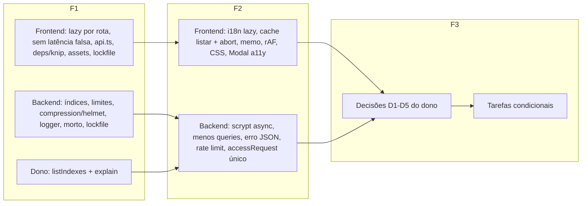

# Otimização e polimento Design

**Spec**: `.specs/features/otimizacao-polimento/spec.md`
**Status**: Draft

---

## Architecture Overview

Nada de arquitetura nova. São ajustes locais em três trilhas que não compartilham arquivo, para rodar em paralelo:

- **Trilha B (Backend)**: `Backend/**` e `.gitignore` da raiz.
- **Trilha F (Frontend)**: `Frontend/**`.
- **Trilha D (dono)**: queries que só o dono roda (regra global: agente não acessa banco) e as respostas D1–D7.

As fases ordenam por risco: F1 (seguro, só soma limites/índices/remoções confirmadas), F2 (muda assinatura ou fluxo, risco médio), F3 (bloqueada por decisão do dono).



---

## Code Reuse Analysis

### Existing Components to Leverage

| Component | Location | How to Use |
| --------- | -------- | ---------- |
| `PageSkeleton` | `Frontend/src/components/common/PageSkeleton.tsx` | Fallback do `<Suspense>` das rotas admin. |
| `EmployeeSkeleton` | `Frontend/src/components/employee/EmployeeSkeleton.tsx` | Fallback do `<Suspense>` em volta do `<Outlet>` do `EmployeeLayout`. |
| Lógica de foco do `BottomSheet` | `Frontend/src/components/employee/BottomSheet.tsx:34-55` | Copiar o trap/restauração para o `Modal` (sem hook novo enquanto só houver 2 usos). |
| `useToast` / `ToastProvider` | `Frontend/src/components/common/Toast.tsx` | Erro de carregar idioma. |
| `lerPeriodo` | `Backend/src/feature/session/sessionService.ts:42` | Exportar `LIMITE_HISTORICO = 500` ao lado; `incidentService` já importa dali. |
| `responderErro` / `ErroHttp` | `Backend/src/utils/responseHandler.ts` | Handler global de erro e `accessRequestController`. |
| `logger` | `Backend/src/utils/logger.ts` | Único logger (o `conn.ts` cria um segundo; unificar na F2). |
| Padrão de teste de índice | `Backend/tests/unit/schemas.test.ts:31,84,118` | `expect(X.schema.indexes()).toContainEqual([...])`, sem banco. |
| `incidentToEvent` | `Frontend/src/data/machines.ts:296` | Já transforma incidente da API em evento; base do D4. |

### Integration Points

| System | Integration Method |
| ------ | ------------------ |
| MongoDB | Índices via `schema.index()`; o `autoIndex` padrão do Mongoose cria no boot. Nenhum script toca o banco. |
| Express 5 | `compression()` e `helmet()` antes das rotas em `app.ts`; `express-rate-limit` só em login e `POST /access-requests`; handler 404/erro no fim. |
| Vite 8 / rolldown | `React.lazy` + `import()` geram chunks por página; locales por `import(\`../locales/${lng}/translation.json\`)`. |
| i18next | `addResourceBundle` + `changeLanguage` depois do `import()`; `pt-BR` continua estático e síncrono (`initAsync: false` mantido). |

---

## Components

### Backend F1

- **Índices** (`schemas/{incident,workSession,user,forklift,accessRequest}.ts`): os da spec OPT-07. Os parciais usam `partialFilterExpression: { campo: { $type: 'objectId' } }` (não `sparse`, que não combina com o `null` explícito usado em `operadorId`/`dispositivoConectadoId`).
- **Limites** (`sessionService.listar`, `incidentService.listar`, `TelemetryRepository.obterTodos`/`obterPorDispositivo`): `.sort(...).limit(LIMITE_HISTORICO)`. Telemetria sobrescreve `obterTodos` no `TelemetryRepository` (não mexe no `RepositoryBase` genérico).
- **HTTP** (`app.ts`): `app.disable('x-powered-by')`, `helmet()`, `compression()` (limiar padrão 1 kB). `cors()` continua aberto (origem do front vem de env; restringir é decisão de deploy).
- **Logger** (`utils/logger.ts`): `transport` só quando `NODE_ENV !== 'production'`; `level: process.env.LOG_LEVEL ?? 'info'`; `redact: ['req.headers.authorization']`.

### Backend F2

- **Senha** (`utils/senha.ts`): `promisify(scrypt)`; `gerarHashSenha`/`verificarSenha` async. Chamadores (grep confirmado): `feature/auth/authService.ts`, `feature/operator/operatorService.ts`, `scripts/seedAdmin.ts`, `scripts/seedData.ts`, e os testes `senha`, `authService`, `operatorService`, `seedAdmin`, `seedData`. (A auditoria citou `accessRequestService.ts:59`, que não existe.)
- **Hash fixo** (`authService.ts:24`): `verificarSenha(senha, HASH_FALSO)` quando o usuário não existe.
- **Caminho do sensor** (`statusService.ts`): `aplicarStatus(forkliftId | doc, novo, empresaId?)` aceita o documento já lido e pula `Branch.findById` quando recebe `empresaId`. `registrarImpacto` repassa o forklift lido. Conta: 10 → 8.
- **Telemetria criar** (`telemetryController.ts`): `Device.exists({ _id, ...filtroPorFilial(escopo) })`.
- **Máquina** (`machineService.ts`): `definirTrava` faz o `updateOne` com filtro de escopo e chama `obterMaquina` uma vez; `populate` com projeção.
- **Erro global** (`app.ts`): 404 JSON para `/api/*` e handler `(err, req, res, next)` que mapeia `SyntaxError` do `express.json` para 400 e o resto para `responderErro`.
- **Rate limit** (`app.ts`): `rateLimit({ windowMs: 15 min, limit: 10 })` no login; `rateLimit({ windowMs: 60 min, limit: 5 })` no POST de acesso. Memória do processo.
- **AccessRequest único** (`schemas/accessRequest.ts` + controller): índice único parcial; `11000` → 409.

### Frontend F1

- **Rotas lazy** (`routes/appRoutes.tsx`): `const X = lazy(() => import('../pages/X'))` para as 14 páginas; `<Suspense fallback={<PageSkeleton />}>` em volta de `<Routes>`. Erro de chunk: boundary pequeno (classe com `getDerivedStateFromError`) com botão recarregar, no mesmo arquivo.
- **EmployeeLayout** (`components/employee/EmployeeLayout.tsx`): `<Suspense fallback={<EmployeeSkeleton … />}>` em volta do `<Outlet />`, para o layout não piscar.
- **Loading real** (`hooks/useEmployeeData.ts`): `loading` = `true` até as duas promises assentarem (`Promise.allSettled`). `AlertasPage` ganha `loading` até a primeira resposta de incidentes.
- **api.ts**: apagar a linha do `Content-Type` e o handler de erro do interceptor de request.

### Frontend F2

- **i18n lazy** (`config/i18n.ts` + `hooks/useLanguage.ts`): `resources` só com `pt-BR`; `carregarIdioma(lng)` faz `import()` + `addResourceBundle` antes do `changeLanguage`. Idioma salvo diferente de pt-BR: carrega no startup e troca quando chegar (primeiro paint em pt-BR por < 1 RTT; aceito).
- **Cache de listar** (`services/machineService.ts`, `services/sectorService.ts`): `Map<filialId, { promise, em }>` com TTL 30 s; mutações chamam `invalidar()`; promise rejeitada sai do Map. `listar(filialId, { signal })` repassa `signal` ao axios. ponytail: cache de módulo sem SWR; trocar por SWR se surgir terceira coleção com cache.
- **ActiveBranchContext**: `useMemo` do `value` + `useCallback` só nos setters expostos.
- **EmployeeSessionPage**: `timeupdate` liga o rAF só na janela de fade (`loopFade < 1`) e desliga fora; `preload="metadata"`; pausa com `matchMedia('(prefers-reduced-motion: reduce)')`.
- **Modal**: foco inicial, trap e restauração copiados do `BottomSheet`.
- **index.css**: `body { font-family: var(--sans) }` + `button, input, select, textarea { font: inherit }`; remover `font-family: inherit` redundantes só onde o teste visual confirmar.
- **Chaves i18n sem uso** (remover dos 7 locales): `common.filter`, `common.noResults`, `common.register`, `machines.statusAvailable`, `machines.statusInUse`, `machines.statusMaintenance`, `machines.operator`, `machines.noOperator`, `employee.settings.name`, `employee.settings.phone`, `employee.settings.position`, `accessRequests.company`, `employee.common.available` (+ `inUse`, `maintenance`, `offline` do mesmo grupo — reconferir com grep antes). Manter `team.loginError` só se o código usar; hoje só o teste usa.

### Dono (Trilha D)

- **T13 — índices e plano** (rodar no mongosh do ambiente e devolver a saída). Os nomes de coleção seguem a pluralização padrão do Mongoose; confirme com `show collections`.

```js
["incidents","worksessions","users","forklifts","accessrequests","telemetries"].forEach(c => { print(c, db.getCollection(c).estimatedDocumentCount()); printjson(db.getCollection(c).getIndexes()) })
db.incidents.find({ filialId: { $in: [ObjectId("<filial>")] }, dataIncidente: { $gte: ISODate("2026-09-01") } }).sort({ dataIncidente: -1 }).limit(500).explain("executionStats")
db.incidents.find({ empilhadeiraId: ObjectId("<forklift>"), status: "pendente" }).explain("executionStats")
db.worksessions.find({ filialId: { $in: [ObjectId("<filial>")] }, operadorId: ObjectId("<operador>") }).sort({ inicio: -1 }).limit(500).explain("executionStats")
db.users.find({ operadorId: { $in: [ObjectId("<operador>")] } }).explain("executionStats")
db.forklifts.find({ dispositivoConectadoId: ObjectId("<device>") }).explain("executionStats")
db.accessrequests.find({ status: "pendente" }).sort({ createdAt: 1 }).explain("executionStats")
db.telemetries.find({ dispositivoId: { $in: [ObjectId("<device>")] } }).sort({ dataDados: -1 }).limit(500).explain("executionStats")
```

  Esperado depois do deploy da F1: `winningPlan` com `IXSCAN` e `totalDocsExamined` ≈ `nReturned`.

- **Antes do índice único (T33)**: `db.accessrequests.aggregate([{ $match: { status: "pendente" } }, { $group: { _id: "$email", n: { $sum: 1 } } }, { $match: { n: { $gt: 1 } } }])` deve voltar vazio.

---

## Error Handling Strategy

| Error Scenario | Handling | User Impact |
| -------------- | -------- | ----------- |
| Chunk de rota falha (deploy novo, rede) | Boundary com "Recarregar" | Mensagem em vez de tela branca. |
| Locale falha ao carregar | Mantém idioma atual + toast | Continua em pt-BR. |
| Listagem passa de 500 | Corta nos 500 mais recentes | Itens antigos do período somem; aceitável até paginação. |
| Índice novo falha no boot (duplicata) | Mongoose loga, app sobe | Nenhum; o dono vê no T13. |
| JSON malformado | 400 `{ message: "JSON inválido." }` | Cliente recebe JSON, não HTML. |
| Rate limit | 429 `{ message }` | Login bloqueado por 15 min após 10 tentativas. |
| Cache de máquinas vencido/rejeitado | Promise sai do Map; próximo `listar` refaz | Retry da tela funciona. |

---

## Risks & Concerns

| Concern | Location (file:line) | Impact | Mitigation |
| ------- | -------------------- | ------ | ---------- |
| Testes de rota síncronos quebram com lazy | `Frontend/src/test/routes/appRoutes.test.tsx`, `src/test/App.test.tsx` | Falsos negativos | Trocar `getBy*` por `findBy*` na mesma tarefa (T15). |
| `i18n.test.ts` (534 linhas) assume os 7 locales em memória | `Frontend/src/test/config/i18n.test.ts` | Teste de paridade quebra | Paridade passa a ler os JSON direto (import nos testes), não via `i18n.getResourceBundle`. |
| Limite 500 trunca alertas antigos sem aviso | `Frontend/src/pages/AlertasPage.tsx:46` | Usuário não vê alerta antigo no período longo | Ordenação desc garante os recentes; paginação fica no backlog. |
| Cache de módulo serve dado velho após mutação em outra aba | `services/machineService.ts` | Até 30 s de lista velha | TTL curto + invalidação local; outra aba não é coberta (aceito). |
| `scrypt` async muda assinatura em seeds e serviços | `Backend/src/utils/senha.ts` | `tsc` aponta todos os chamadores | Uma tarefa só (T25) para o build nunca ficar quebrado entre commits. |
| Mocks de Mongoose contam chamadas, não comportamento | `Backend/tests/unit/*Service.test.ts` | Teste de "≤ 8 operações" depende dos mocks | Contar chamadas a todos os models mockados num helper do próprio teste; `explain` do dono cobre o banco. |
| Rate limit em memória por processo | `Backend/src/app.ts` | Com várias instâncias o limite multiplica | Aceito (uma instância hoje [H]); store externo só com escala. |
| `cors()` aberto | `Backend/src/app.ts:22` | Qualquer origem chama a API com token | Fora do escopo; registrar no STATE como pendência de deploy. |
| `/api/reset` público apaga o banco | `Backend/src/app.ts` (rota antes de `autenticar`), `feature/reset/resetRouter.ts:7` | Perda total de dados por um GET | D1 (F3); não executar sem o dono. |
| Página de saúde devolve HTML e não checa o banco | `Backend/src/app.ts:44` | Health falso-positivo | Backlog; não entra por não ser otimização. |

---

## Tech Decisions (only non-obvious ones)

| Decision | Choice | Rationale |
| -------- | ------ | --------- |
| compression/helmet/rate-limit | Pacotes `compression`, `helmet`, `express-rate-limit` | Segurança e edge cases (Vary, ETag, janelas) que código à mão erraria; 3 deps pequenas e padrão do Express. |
| Índice parcial x sparse | `partialFilterExpression: { $type: 'objectId' }` | `sparse` indexa `null` explícito; os campos usam `default: null`. |
| Cache de listagem | Map de módulo com TTL 30 s | Duas coleções só; SWR seria dependência nova para o mesmo efeito. |
| Limite fixo 500 | Constante, sem query param | YAGNI até a UI paginar. |
| Fonte self-host | Fora desta feature | Precisa dos arquivos woff2 e da lista real de pesos [H]; backlog. |
