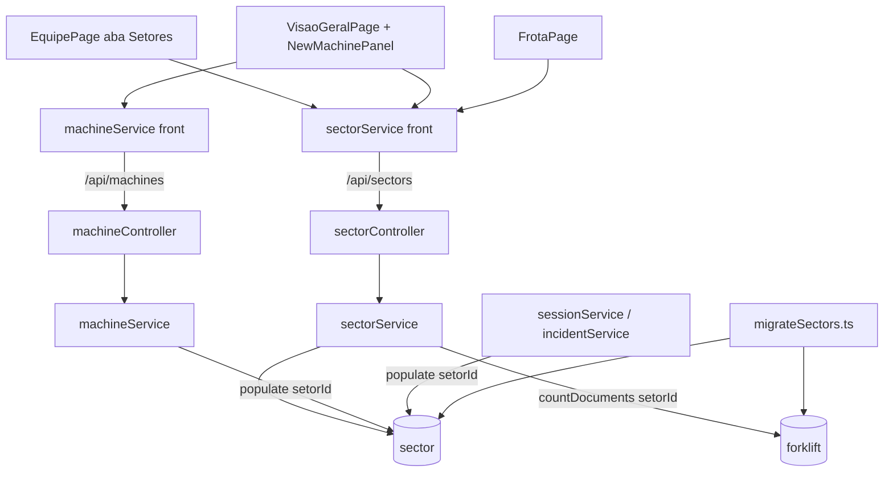

# Setores pela API Design

**Spec**: `.specs/features/sectors/spec.md`
**Status**: Approved

---

## Architecture Overview

Conforma com AD-008 (setor pertence a uma filial), AD-010 (escopo relido a cada requisição, filtro por filial), AD-011 (`/api/forklifts` não muda o que tem regra própria) e AD-012 (admin guard, atualização otimista com rollback).



---

## Code Reuse Analysis

| Component | Location | How to Use |
| --------- | -------- | ---------- |
| Padrão service/controller/router | `Backend/src/feature/category/*`, `feature/operator/*` | Copiar formato: `lerId`, `lerDados`, `traduzirErro` (11000 → 409), `respostaSucesso`/`responderErro` |
| Escopo | `Backend/src/core/escopo.ts` | `filtroPorFilial` no listar/achar, `resolverFilial` no criar e mover, `exigirEmpresa` para mudar filial |
| Guard de admin | `Backend/src/core/autenticar.ts` (`exigirAdmin`) | `POST/PUT/DELETE /api/sectors` |
| Corpo seguro | `Backend/src/utils/corpo.ts` (`exigirSemOperadores`) | Todo corpo de `POST/PUT` |
| Collation | `Backend/src/schemas/category.ts` | Mesmo `{ locale: 'pt', strength: 2 }` no índice `{ filialId, nome }` |
| Script idempotente | `Backend/src/scripts/migrateStatus.ts` | Mesmo formato: função pura + `...EDesconectar` + guard `import.meta.url` |
| Otimista + rollback | `Frontend/src/pages/EquipePage.tsx` (funcionários), `VisaoGeralPage.tsx` | Mesmo `saveOptimistic` e toast `showError` |
| Filial ativa | `Frontend/src/context/ActiveBranchContext.tsx` | `activeBranch`, `branches`, `canManage` (escopo empresa) |

---

## Components

### Backend `sector` schema
- **Location**: `Backend/src/schemas/sector.ts`
- `nome: { String, trim, required, maxlength: 60 }`, `filialId: { ObjectId ref 'branch', required, index }`; índice único `{ filialId: 1, nome: 1 }` com a collation de `category`.
- `forklift.setorId: { ObjectId ref 'sector', default: null, index: true }`.

### Backend `sectorService`
- **Location**: `Backend/src/feature/sector/sectorService.ts`
- `listar(escopo, filialId?)` → `Setor[]` ordenado por nome, com `populate('filialId', 'nome')`.
- `criar(escopo, { nome, filialId })`, `atualizar(escopo, id, { nome?, filialId? })`, `excluir(escopo, id)`.
- `exigirSetorDaFilial(setorId, filialId)` — usado pelo `machineService` (400 se o setor não existe nessa filial).
- `contarMaquinas(id)` = `Forklift.countDocuments({ setorId: id })`; 409 no excluir e no mover.
- Formato: `{ _id, nome, filialId, filial: { nome } }`.

### Backend `sectorController` + `sectorRouter`
- **Location**: `Backend/src/feature/sector/`; montado em `app.ts` como `/api/sectors`.
- `listar` sem guard de role; demais com `exigirAdmin(req.usuario, "Apenas administradores podem gerenciar setores.")`.
- `atualizar`: campos aceitos `nome` e `filialId` (formato checado no controller). O service compara com a filial atual: se muda, exige escopo empresa (`exigirEmpresa`, 403), passa por `resolverFilial` e recusa com 409 se o setor tem máquinas; mesma filial é ignorada.

### Backend `machineService` / `machineController`
- `CAMPOS_MAQUINA` troca `setor` por `setorId`; `lerDadosMaquina` valida `setorId` (ObjectId ou `null`).
- `criarMaquina`/`atualizarMaquina` chamam `exigirSetorDaFilial` quando `setorId` não é `null`.
- `consultar` faz `populate('setorId', 'nome')`; resposta `setor: f.setorId?.nome ?? ''`, `setorId: f.setorId ? String(f.setorId._id) : null`. Setor apagado: populate dá `null` → `setor: ''`; o `setorId` cru se perde no populate, então lê-se antes (`f.setorId?._id ?? null`). Ver Risks.

### Backend `forkliftController`
- `CAMPOS_PROTEGIDOS` ganha `setorId`; com `filialId` no corpo grava `setorId: null`.

### Backend sessão e ocorrência
- `sessionService`/`incidentService` buscam as máquinas com `populate('setorId', 'nome')` e devolvem `setor: maquina.setorId?.nome ?? ''`.

### Scripts
- `Backend/src/scripts/migrateSectors.ts`: `migrarSetores()` + `migrarSetoresEDesconectar`. Busca `Forklift.find({ setorId: null, setor: { $exists: true, $ne: '' } })` (Mongo: `null` casa ausente). Agrupa por `filialId` + nome em minúsculas (`toLocaleLowerCase('pt')`); acha com `Sector.findOne({ filialId, nome }).collation(...)` ou cria; `Forklift.updateOne({ _id, setorId: null }, { $set: { setorId } })`. Script `migrate:sectors` no `package.json`.
- `seedData.ts`: upsert `Sector.findOneAndUpdate({ filialId, nome }, {}, { upsert, new })` por texto distinto, depois grava `setorId` na empilhadeira. `resetData.ts`: `Sector` em `COLECOES`.

### Frontend
- `services/sectorService.ts`: `listar(filialId?)`, `criar({ nome, filialId? })`, `atualizar(id, { nome, filialId? })`, `remover(id)`. Tipo `Setor = { _id, nome, filialId, filial: { nome } }`.
- `data/team.ts`: `Sector` passa a ser `Setor` (reexport), `SECTORS` sai, `filterSectors` busca em `nome` e `filial.nome`.
- `SectorCard`/`SectorInfoModal`: mostram `filial.nome`.
- `SectorFormModal`: props `branches`, `canMove`; select de filial quando `canMove` ou (criando e `branches.length >= 2`), senão texto só-leitura com o nome da filial.
- `EquipePage`: setores carregados junto com operadores (`Promise.all`), otimista em criar/editar/excluir; erro mostra a `message` da API (409 com contagem).
- `NewMachinePanel`: recebe `sectors: Setor[]` e `filialId` da máquina/ativa; select "Sem setor" + setores da filial do formulário; trocar filial zera `setorId`.
- `data/machines.ts`: `Machine` ganha `setorId: string | null` e `filialId?: string`; `filterMachines` aceita `setorId`. `data/fleet.ts`: `matchesMachine` igual (FrotaPage filtra por `setorId` antes).
- `machineService`: corpo leva `setorId` no lugar de `setor`.

---

## Data Models

```typescript
interface Sector { _id: ObjectId; nome: string; filialId: ObjectId }      // índice único { filialId, nome } collation pt/2
interface Forklift { /* ... */ setorId: ObjectId | null; setor?: string /* legado, não lido */ }
// API
interface SetorApi { _id: string; nome: string; filialId: string; filial: { nome: string } }
interface MachineApi { /* ... */ setor: string; setorId: string | null }
```

---

## Error Handling Strategy

| Error Scenario | Handling | User Impact |
| -------------- | -------- | ----------- |
| Nome repetido na filial | 11000 → 409 | Toast com a mensagem da API; lista volta |
| Excluir/mover setor com máquinas | 409 com contagem | Toast com a contagem; card volta |
| `setorId` de outra filial | 400 | Toast "erro ao salvar"; máquina volta |
| Falha na listagem de setores | Equipe: estado de erro com nova tentativa; Visão Geral/Frota: filtro e select ficam só com "Todos"/"Sem setor" | A página principal continua |

---

## Risks & Concerns

| Concern | Location (file:line) | Impact | Mitigation |
| ------- | -------------------- | ------ | ---------- |
| Excluir setor e ligar máquina ao mesmo tempo (sem transação) | `feature/sector/sectorService.ts` | Máquina com `setorId` de setor apagado | `GET` devolve `setor: ''`; comentário `ponytail:`; transação quando houver replica set |
| `PUT /api/forklifts/:id` aceita qualquer campo livre (inclusive `setor`) | `Backend/src/feature/forklift/forkliftController.ts:106` | Texto legado pode mudar, mas não é mais lido | Aceito; `setorId` entra nos protegidos |
| Mudar nome do setor reflete em todas as telas via populate | `machineService.ts:31` | Uma consulta a mais por listagem | `populate` faz uma consulta só por lista, sem N+1 |

---

## Tech Decisions

| Decision | Choice | Rationale |
| -------- | ------ | --------- |
| Nome do setor na resposta | `populate('setorId', 'nome')`, sem desnormalizar | Renomear não precisa atualizar máquinas |
| Lista de setores nas telas de máquina | Uma busca por página (`listar(filialId ativa)`), filtrada no front pela filial do formulário | Sem nova requisição ao trocar filial no formulário |
