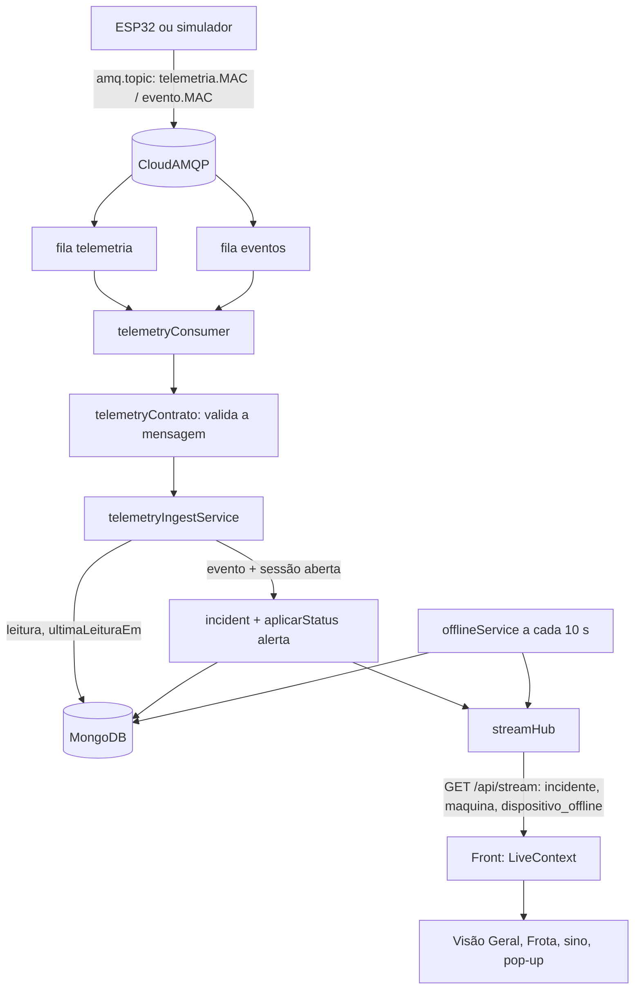

# Telemetria pela fila (RabbitMQ) Design

**Spec**: `.specs/features/telemetry-queue/spec.md`
**Context**: `.specs/features/telemetry-queue/context.md`
**Status**: Approved (dono confirmou duas filas; R1, R3 e R5 seguem os padrões; R4: mesmas filas em dev e prod, um backend por vez)

---

## Architecture Overview

O ESP32 (ou o simulador) publica no exchange `amq.topic` do CloudAMQP. Duas filas, `telemetria` e `eventos`, ficam ligadas a ele. O backend consome as duas no mesmo processo da API, grava no Mongo e avisa o front por SSE. O firmware não fala com a API.



**Abordagem.** O dono já escolheu o consumidor no mesmo processo e o SSE; eles ficam como decisões fechadas. A topologia é a única parte em aberto (seção Tech Decisions).

---

## Code Reuse Analysis

### Existing Components to Leverage

| Component | Location | How to Use |
| --------- | -------- | ---------- |
| `aplicarStatus` (único caminho de status, categoria e trava) | `Backend/src/feature/machine/statusService.ts` | Evento chama `aplicarStatus(id, "alerta")`; offline chama com `manutencao`; ganha o gancho que publica `maquina` e zera `manutencaoPorOffline` |
| `registrarImpacto` | mesmo arquivo | Fica como está (legado do `forcaImpacto`) |
| `DeviceRepository.obterPorMac` | `Backend/src/feature/device/deviceRepository.ts` | Achar o dispositivo pelo MAC; o cadastro já grava o MAC em maiúsculas |
| `WorkSessionRepository.obterUm({ empilhadeiraId, fim: null })` | `Backend/src/feature/session/workSessionRepository.ts` | Regra "só com sessão aberta" |
| `IncidentRepository` / `IncidentModel` | `Backend/src/feature/incident/` | Criar o incidente; `formatar` do `incidentService` (hoje privado) vira exportado para o payload SSE |
| `filtroPorFilial` e `Escopo.filiais` | `Backend/src/core/escopo.ts` | O hub guarda as filiais do escopo de cada conexão |
| `autenticar` | `Backend/src/core/autenticar.ts` | `GET /api/stream` entra depois do `app.use("/api", autenticar)`, sem código de auth novo |
| `listarMaquinas` / `consultar` | `Backend/src/feature/machine/machineService.ts` | Ganha `dispositivoOffline` e `alertaTipos`; o payload `maquina` reaproveita o mesmo formato |
| `POLL_INTERVAL_MS`, fila e `AlertModal` | `Frontend/src/context/AlertsContext.tsx` | O pop-up e o sino seguem iguais; só a fonte dos incidentes novos passa a ser o stream |
| `moveMachine`, `markArrived` | `Frontend/src/data/fleet.ts`, `FrotaPage.tsx` | Mover o card ao receber `maquina`, com o destaque de chegada que já existe |
| `ACCIDENT_URGENCY`, `eventUrgency`, `incidentToEvent` | `Frontend/src/data/machines.ts` | Estendidos para os 5 tipos |
| Tokens de cor de offline | `StatusBadge.module.css`, `MachineCard.module.css` | O card cinza reaproveita o tom de `offline` |

### Integration Points

| System | Integration Method |
| ------ | ------------------ |
| CloudAMQP | `amqplib` (nova dependência do Backend), `RABBITMQ_URL` do `.env`; declara filas e `bindQueue` no boot |
| MongoDB | Schemas existentes ganham campos; nenhuma coleção nova |
| Front → API | `fetch` com stream em `GET /api/stream`, token no cabeçalho `Authorization` |

---

## Components

### telemetryContrato (Backend)

- **Purpose**: Tipos e validação do contrato da mensagem, mais os montadores usados pelo simulador.
- **Location**: `Backend/src/feature/telemetry/telemetryContrato.ts`
- **Interfaces**:
  - `lerMensagem(buffer: Buffer): Mensagem | null` - JSON → `MensagemTelemetria | MensagemEvento`; `null` se inválida (tipo, `dispositivo`, `movimento` finito, `evento.tipo` entre os 5)
  - `TIPOS_EVENTO` - os 5 tipos
  - `montarTelemetria(mac, movimento)` / `montarEvento(mac, tipo, movimento)` - mensagens no formato do firmware
- **Dependencies**: nenhuma (não importa `conn`, para o simulador não abrir o Mongo)
- **Reuses**: nenhum

### telemetryConsumer (Backend)

- **Purpose**: Conexão AMQP, topologia, consumo e reconexão.
- **Location**: `Backend/src/feature/telemetry/telemetryConsumer.ts`
- **Interfaces**:
  - `iniciarConsumidor(): Promise<void>` - sem `RABBITMQ_URL` loga aviso e volta; senão conecta, declara `exchange amq.topic` (assert), as duas filas duráveis com `x-message-ttl`, e os `bindQueue`
  - `tratar(msg, canal)` - `lerMensagem` → `processarMensagem`; ack no sucesso e nos descartes; erro de banco: `nack` com requeue se `!msg.fields.redelivered`, senão descarta
- **Dependencies**: `amqplib`, `telemetryContrato`, `telemetryIngestService`, `logger`
- **Reuses**: `utils/logger.ts`

### telemetryIngestService (Backend)

- **Purpose**: Regras de negócio de uma mensagem.
- **Location**: `Backend/src/feature/telemetry/telemetryIngestService.ts`
- **Interfaces**:
  - `processarMensagem(msg: Mensagem, agora = new Date()): Promise<void>`
    1. acha o dispositivo pelo MAC (maiúsculas) e a empilhadeira por `dispositivoConectadoId`; senão descarta com log
    2. grava `ultimaLeituraEm`; se `offlineDesde`, limpa e trata a volta (manutenção automática → `disponivel`); publica `maquina`
    3. `telemetria`: grava a leitura com `movimento`
    4. `evento`: sem sessão aberta, descarta com log; com sessão, cria o incidente (`tipo`, `movimento`, `operadorId` da sessão), chama `aplicarStatus(id, "alerta")` e publica `incidente`
- **Dependencies**: repositórios de `Device`, `Forklift`, `Telemetry`, `Incident`, `WorkSession`; `aplicarStatus`; `streamHub`
- **Reuses**: `statusService`, `incidentService.formatar`

### offlineService (Backend)

- **Purpose**: Varredor que marca a placa sem comunicação.
- **Location**: `Backend/src/feature/telemetry/offlineService.ts`
- **Interfaces**:
  - `varrerOffline(agora = new Date()): Promise<void>` - empilhadeiras com `dispositivoConectadoId`, `ultimaLeituraEm < agora - 30 s` e `offlineDesde` vazio: grava `offlineDesde`; se `disponivel`, `aplicarStatus(manutencao)` e `manutencaoPorOffline: true`; publica `maquina` e `dispositivo_offline`
  - `iniciarVarredor(): void` - `setInterval` de 10 s, com `unref()` para não segurar o processo; um tick não começa enquanto o anterior roda
- **Dependencies**: `Forklift`, `aplicarStatus`, `streamHub`
- **Reuses**: `statusService`

### streamHub + rota (Backend)

- **Purpose**: Mantém as conexões SSE e publica por filial.
- **Location**: `Backend/src/feature/stream/streamHub.ts`, `streamRouter.ts`
- **Interfaces**:
  - `conectar(req, res): void` - cabeçalhos `text/event-stream`, `Cache-Control: no-cache`, `X-Accel-Buffering: no`; guarda `{ res, filiais: Set<string> }` de `req.escopo`; remove no `close`
  - `publicar(evento: "incidente" | "maquina" | "dispositivo_offline", filialId: string, dados: object): void` - escreve `event:`/`data:` só nas conexões cujo `filiais` tem a filial
  - heartbeat: comentário `: ping` a cada 25 s
  - `publicarMaquina(forkliftId): Promise<void>` - lê a empilhadeira e o incidente pendente e publica o payload `maquina`
- **Dependencies**: `Escopo`, `Forklift`, `Incident`
- **Reuses**: `autenticar` (a rota entra depois dele em `app.ts`)
- **Atenção**: `compression()` em `app.ts` bufferiza a resposta; o `filter` do compression passa a pular `/api/stream`

### Gancho em statusService (Backend)

- **Purpose**: Todo caminho de mudança de status avisa o front.
- **Location**: `Backend/src/feature/machine/statusService.ts` (modificar) e `machineService.ts` (`definirTrava`, `moverParaCategoria`)
- **Interfaces**: depois de gravar, `publicarMaquina(id)`; `aplicarStatus` também grava `manutencaoPorOffline: false` em toda mudança de status
- **Reuses**: o próprio `aplicarStatus`

### simulateHardware (Backend)

- **Purpose**: Simular as placas publicando na fila.
- **Location**: `Backend/src/scripts/simulateHardware.ts` e script `simulate:hardware` no `package.json`
- **Interfaces**: `yarn simulate:hardware --mac AA:BB:.. [--mac ..] [--intervalo 5] [--evento colisao]`; também lê teclas (`c`, `f`, `a`, `u`, `i`) para disparar cada evento; Ctrl+C fecha a conexão
- **Dependencies**: `amqplib`, `telemetryContrato` (nunca `conn`)
- **Reuses**: `montarTelemetria`, `montarEvento`

### LiveContext (Frontend)

- **Purpose**: Uma conexão SSE por usuário logado e reconexão.
- **Location**: `Frontend/src/context/LiveContext.tsx`, `Frontend/src/services/streamService.ts`
- **Interfaces**:
  - `streamService.abrir(onEvento, signal)` - `fetch` + `ReadableStream`, parser SSE mínimo, cabeçalho `Authorization`
  - `useLive(tipo, handler)` - assina um tipo de evento; `onReconnect(cb)` para recarregar as listas
  - backoff de 1 s até 30 s; fecha no logout (`user` nulo)
- **Dependencies**: `authService.getSession()`, `ActiveBranchContext`
- **Reuses**: o padrão de contexto de `AlertsContext`

### Páginas e componentes do Frontend

- **VisaoGeralPage / FrotaPage**: `useLive("maquina", patch)` mescla `status`, `categoriaId`, `categoriaTravada`, `alertaEm`, `alertaTipos`, `dispositivoOffline` na máquina; a Frota também move o card (`moveMachine`) e chama `markArrived`; id desconhecido recarrega a lista.
- **MachineCard / FleetCard**: `dispositivoOffline` aplica o tom cinza sem mudar a coluna; o card de acidente calcula a urgência por `urgenciaDaMaquina(machine)`.
- **AlertsContext**: troca o diff por polling por `useLive("incidente")`; o polling passa a 60 s; `useLive("dispositivo_offline")` alimenta uma fila própria de pop-ups de offline.
- **AlertModal**: variante `offline` com o texto traduzido.
- **data/machines.ts**: `AccidentCause` vira os 5 tipos do backend; `ACCIDENT_URGENCY` e `incidentToEvent` usam `incident.tipo ?? "colisao"`; novo `urgenciaDaMaquina`.
- **LevelInfoModal e i18n**: os 5 tipos nos 7 idiomas (chaves renomeadas de `frenagem` e `tombamento`).

---

## Data Models

```typescript
// schemas/forklift.ts (campos novos)
ultimaLeituraEm?: Date            // última mensagem válida da placa
offlineDesde?: Date | null        // marca de sem comunicação; null = comunicando
manutencaoPorOffline: boolean     // default false; true só quando o varredor pôs em manutencao

// schemas/incident.ts (campos novos)
tipo?: "colisao" | "frenagem_brusca" | "aceleracao_brusca" | "curva_brusca" | "inclinacao_excessiva"
movimento?: Movimento

// schemas/telemetry.ts (campos novos)
movimento?: Movimento
// índice TTL: { dataDados: 1 }, { expireAfterSeconds: 7 * 24 * 3600 }

interface Movimento {
  aceleracaoX: number; aceleracaoY: number; aceleracaoZ: number
  inclinacaoX: number; inclinacaoY: number; magnitude: number
}

// /api/machines (campos novos na resposta)
dispositivoOffline: boolean       // offlineDesde != null
alertaTipos: string[]             // tipos distintos dos incidentes pendentes, mais recente primeiro

// eventos SSE
incidente:           Incidente (formato de GET /api/incidents)
maquina:             { id, filialId, status, categoriaId, categoriaTravada, alertaEm, alertaTipos, dispositivoOffline }
dispositivo_offline: { machineId, identificacao, filialId }
```

**Relationships**: `forklift.dispositivoConectadoId` → `device.enderecoMac` (índice único, maiúsculas); `incident.empilhadeiraId` → `forklift`; a leitura se liga ao `device` por `dispositivoId`.

---

## Error Handling Strategy

| Error Scenario | Handling | User Impact |
| -------------- | -------- | ----------- |
| Mensagem inválida, MAC desconhecido, dispositivo sem máquina, evento sem sessão | Log (`warn`) e ack; sem requeue | Nenhum |
| Erro de banco ao processar | `nack` com requeue na primeira vez; descarte com log de erro na reentrega | Um evento pode atrasar um ciclo |
| Broker fora do ar | A API sobe; reconexão com espera de 1 s até 30 s | Sem tempo real até voltar; o polling de 60 s cobre |
| Filas já existem com argumentos diferentes (`PRECONDITION_FAILED`) | Log com a instrução de apagar a fila no painel do CloudAMQP e reiniciar | Consumo desligado até o dono agir |
| Conexão SSE cai | O front reconecta com espera crescente e recarrega as listas | Atraso de alguns segundos |
| Escrita em conexão SSE morta | `try/catch` por cliente; remove o cliente | Nenhum |

---

## Risks & Concerns

| Concern | Location (file:line) | Impact | Mitigation |
| ------- | -------------------- | ------ | ---------- |
| `compression()` bufferiza a resposta e o SSE não chega | `Backend/src/app.ts:30` | Eventos só aparecem ao fechar a conexão | `filter` do compression pula `/api/stream`; teste de integração do stream com supertest-like sobre `http` real |
| `aplicarStatus` grava o status e depois resolve incidentes sem transação | `statusService.ts:42` (comentário `ponytail`) | Falha no meio deixa incidentes pendentes | Já registrado; não piora com a feature; o gancho SSE entra só depois das gravações |
| Dois consumidores (dev e prod) na mesma fila dividem as mensagens | `Backend/.env.example` | O backend que você não está olhando "rouba" o evento do simulador | Dono aceitou: um backend por vez; `RABBITMQ_PREFIXO` existe se precisar separar (R4) |
| Plano gratuito: cerca de 1 milhão de mensagens por mês e 20 conexões | CloudAMQP | Cota estoura com muitas placas a 5 s | Simulador mostra a estimativa; firmware pode subir o intervalo; conexões usadas: 1 do backend, 1 por simulador |
| Evento atrasado cria alerta com horário errado (`dataIncidente` é o do recebimento) | `telemetryIngestService` | Backend fora do ar por 1 h gera alertas velhos como novos | `x-message-ttl` curto nas duas filas (R3) |
| `GET /api/incidents` lê até 500 incidentes por consulta e o sino fazia isso a cada 15 s | `AlertsContext.tsx` (comentário `ponytail`) | Carga no Mongo por usuário | O stream tira o polling de 15 s; fica 60 s |
| Testes de `AlertsContext`, `LevelInfoModal` e `levelInfoLocales` dependem das causas antigas | `Frontend/src/test/` | Quebram ao renomear `frenagem` e `tombamento` | A task de urgência atualiza esses testes no mesmo commit |
| O seed escreve leituras com data fixa antiga | `Backend/src/scripts/seedDataset.ts` | O TTL as apaga | Seed passa a gerar datas relativas a agora (spec TLQ-08) |
| `req.escopo` é lido na conexão e não muda durante ela | `streamHub.conectar` | Admin que ganha filial só vê eventos novos ao reconectar | Aceito; o front reconecta ao trocar a filial ativa |

---

## Tech Decisions (only non-obvious ones)

| Decision | Choice | Rationale |
| -------- | ------ | --------- |
| Exchange | `amq.topic`, com routing key `<prefixo>telemetria.<MAC>` e `<prefixo>evento.<MAC>` (R1) | O plugin MQTT publica em `amq.topic` por padrão; o simulador e um futuro gateway HTTP usam o mesmo caminho |
| Filas | Duas, `telemetria` e `eventos` (R2) | Depois de uma queda, evento não espera atrás de leituras antigas |
| TTL das mensagens | `telemetria` 60 s, `eventos` 5 min (R3) | Leitura velha não serve; evento velho criaria alerta com horário errado |
| Isolamento por ambiente | Dono: dev e prod usam as mesmas filas; `RABBITMQ_PREFIXO` (padrão vazio) existe só como opção (R4) | Projeto de faculdade; regra: um backend por vez |
| Mensagem inválida | Descarta com log, sem dead-letter (R5) | Cada mensagem conta na cota; dead-letter vira melhoria depois |
| Usuário de publicação | O firmware usará um usuário só de escrita no exchange, criado no painel do CloudAMQP, quando o transporte for decidido (R6) | A credencial fica gravada na placa |
| Criação das filas | O backend declara no boot; mudar argumentos exige apagar a fila no painel | Idempotente e sem passo manual no primeiro uso |
| Parser de SSE no front | Parser próprio de uns 30 linhas sobre `fetch` | `EventSource` não aceita cabeçalho; evita dependência sem manutenção |
| Quem dispara o `maquina` | Gancho em `aplicarStatus` e nas rotas de trava e categoria | Cobre sessão, evento, manual e offline sem duplicar código |
| Urgência da máquina | `/api/machines` devolve `alertaTipos`; o front calcula a maior | A tabela de urgência é só do front (D2) |
| Onde iniciam o consumidor e o varredor | `server.ts`, depois do `listen` | `app.ts` fica sem efeito colateral para os testes |

> **Project-level decisions:** a arquitetura fila → consumidor → SSE vira `AD-014` em `.specs/STATE.md`.
