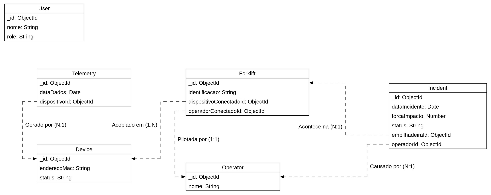

# Modelagem de Dados - Liftech

Entidades e mapeamento do banco de dados (MongoDB/Mongoose) do projeto Liftech.

## Padrões Adotados
- **Arquivos e Classes**: Nomes no singular (ex: `device.ts`, `Device`).
- **Atributos e Propriedades**: Propriedades declaradas em camelCase (ex: `dataIncidente`, `enderecoMac`).
- **Chaves Estrangeiras**: Campos que referenciam ObjectIds de outras coleções possuem o sufixo `Id` (ex: `dispositivoId`, `operadorId`).

## Diagrama de Relacionamento
Veja o diagrama de comunicação das entidades:

*(Nota: as entidades no diagrama original sofreram padronizações de nomenclatura documentadas abaixo)*

## Entidades e Schemas

### 1. User (`user.ts`)
Usuário do sistema, como um Gestor ou Administrador que acessa a plataforma web.
- `nome` (String): Nome completo.
- `role` (String): Papel de acesso ou cargo no sistema (ex: "Admin", "Supervisor").
- `empresaId` (ObjectId, obrigatório): Referência para a `Company` do usuário.
- `escopo` (String): `empresa` (enxerga todas as filiais da empresa) ou `filiais` (só as de `filiaisIds`). Padrão `filiais`.
- `filiaisIds` (ObjectId[]): Filiais que o usuário enxerga quando o `escopo` é `filiais`. Lista vazia não enxerga nenhuma filial.
- `operadorId` (ObjectId, opcional): `Operator` que o colaborador é. O `user` serve só para o login; quem retira a máquina é o operator.

O `role` diz o que o usuário vê; o `escopo` diz onde ele atua. São eixos independentes.

### 2. Operator (`operator.ts`)
Motorista ou piloto das empilhadeiras.
- `nome` (String): Nome do operador.
- `filialId` (ObjectId, obrigatório): Referência para a `Branch` do operador.

### 3. Device (`device.ts`)
Equipamento físico acoplado a uma empilhadeira para captar telemetria.
- `enderecoMac` (String): Endereço físico único de rede.
- `status` (String): Conectividade do hardware (`online` ou `offline`). Não é lido pela API; o status da máquina fica na `Forklift`.
- `filialId` (ObjectId, obrigatório): Referência para a `Branch` do dispositivo.

### 4. Telemetry (`telemetry.ts`)
Leituras constantes de dados gerados pelos dispositivos.
- `dataDados` (Date): Timestamp da leitura.
- `dispositivoId` (ObjectId): Referência para o `Device` (relação N:1).
- `forcaImpacto` (Number, opcional): Impacto lido. A partir de `LIMITE_IMPACTO` gera incidente e põe a máquina em `alerta`.

### 5. Forklift (`forklift.ts`)
Empilhadeira física e o status de seu uso.
- `identificacao` (String): Código ou frota.
- `dispositivoConectadoId` (ObjectId): Qual `Device` rastreia a empilhadeira.
- `operadorConectadoId` (ObjectId): Qual `Operator` pilota a máquina.
- `filialId` (ObjectId, obrigatório): Referência para a `Branch` da empilhadeira.
- `status` (String): `disponivel`, `em_uso`, `manutencao`, `alerta` ou `offline`. `null` em dado antigo, lido como `disponivel`.
- `statusAlteradoEm` (Date): Quando o status mudou pela última vez.
- `categoriaId` (ObjectId): Referência para a `Category` (coluna do kanban). `null` = sem categoria.
- `categoriaTravada` (Boolean): Com `true`, mudança de status não move a máquina de categoria. Padrão `false`.

### 6. Incident (`incident.ts`)
Registro de anomalias, como batidas ou paradas bruscas.
- `dataIncidente` (Date): Data e hora da ocorrência.
- `forcaImpacto` (Number): Impacto lido pelo sensor.
- `status` (String): Status de tratamento do incidente.
- `empilhadeiraId` (ObjectId): Referência da `Forklift` envolvida.
- `operadorId` (ObjectId): Referência do `Operator` envolvido.
- `filialId` (ObjectId, obrigatório): Referência para a `Branch` do incidente.
- `origem` (String): `sensor` (leitura de impacto) ou `funcionario` (ocorrência reportada na sessão). Padrão `sensor`.
- `descricao` (String, opcional): Texto da ocorrência, até 500 caracteres.

### 6.1. WorkSession (`workSession.ts`)
Sessão de uso de uma máquina por um operador.
- `operadorId` (ObjectId, obrigatório): `Operator` da sessão.
- `empilhadeiraId` (ObjectId, obrigatório): `Forklift` usada.
- `filialId` (ObjectId, obrigatório, indexado): `Branch` da máquina.
- `inicio` (Date, obrigatório) e `fim` (Date, `null` enquanto aberta).
- Índices únicos parciais `{ operadorId }` e `{ empilhadeiraId }` onde `fim: null`: no máximo uma sessão aberta por operador e por máquina.

### 7. Company (`company.ts`)
Empresa cliente. Todo usuário e toda filial pertencem a uma.
- `nome` (String, obrigatório): Nome da empresa. Único.

### 8. Branch (`branch.ts`)
Filial de uma empresa. A matriz é uma filial normal com `matriz: true`.
- `nome` (String, obrigatório): Nome da filial. Único dentro da empresa.
- `empresaId` (ObjectId, obrigatório): Referência para a `Company`.
- `matriz` (Boolean): `true` para a matriz da empresa. Padrão `false`. Cada empresa tem no máximo uma matriz (índice único parcial); a matriz não pode ser excluída.

### 9. Category (`category.ts`)
Coluna do kanban da Frota, da empresa toda.
- `empresaId` (ObjectId, obrigatório): Referência para a `Company`.
- `nome` (String, obrigatório): Até 40 caracteres. Único na empresa sem diferenciar maiúscula de minúscula.
- `cor` (String, obrigatório): `#RRGGBB`.
- `chave` (String): Chave das categorias iniciais para tradução; `null` depois de renomeada.
- `statusVinculados` (String[]): Status que levam a máquina para esta categoria. Cada status fica em no máximo uma categoria da empresa.

Os recursos (`Forklift`, `Device`, `Operator`, `Incident`) guardam só o `filialId`; a empresa de um recurso vem da sua filial. A `Telemetry` é isolada pelo seu `Device`.

## Migração para filiais
O banco anterior às filiais não tem `empresaId` nos usuários nem `filialId` nos recursos. O dono roda `yarn migrate:branches` (em `Backend`): o script cria a empresa padrão e a matriz, define nos admins `escopo: empresa`, nos demais usuários `escopo: filiais` com a matriz, e põe todos os recursos sem filial na matriz. Só documentos sem o campo são alterados, então rodar de novo não muda nada. O `yarn seed:data` usa a mesma empresa e matriz.
